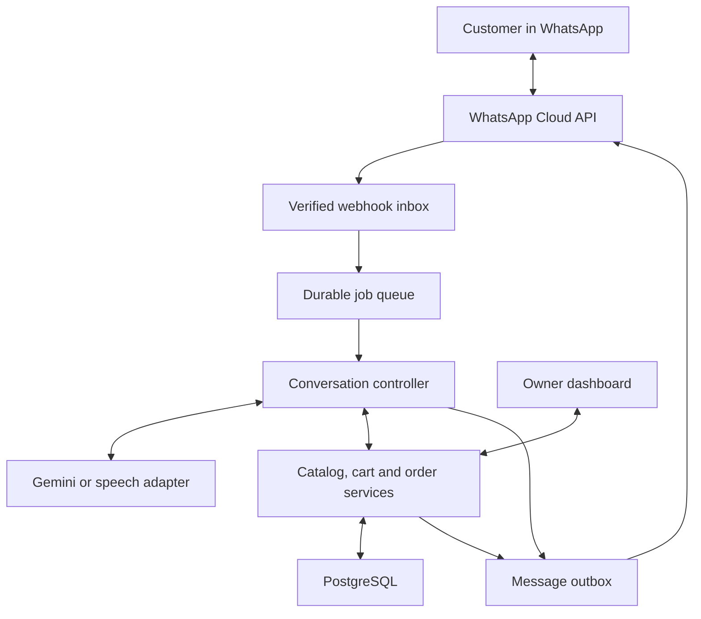

**WhatsApp store ordering bot — architecture and implementation blueprint**

Prepared 26 September 2026. Intended pilot: one Indian shop, pickup only, English plus the shop's chosen local language, text and recorded voice messages, a custom server-side cart, owner acceptance, and optional manually verified UPI advances. The technologies and defaults below are design recommendations; cited platform capabilities come from the linked sources. This is a design document, not a deployed bot.

**1. Recommended product**

Build an ordering assistant that lets customers describe what they want, choose actual products and variants, add multiple items, review the total, request pickup, and receive an owner-confirmed order. Use WhatsApp as the conversation channel. Your backend owns customer records, product availability, carts, orders, payment records, and permissions. Gemini helps interpret natural language and voice and can phrase replies using facts supplied by the backend.

The essential rule is: AI proposes an interpretation or permitted action; application code validates and executes it. A friendly answer is never evidence that stock exists, an order was accepted, or money arrived.

For the first pilot, use pay at pickup for ordinary stock. Enable advances selectively for items the owner must prepare or purchase specially. A ₹5–₹10 advance is a business experiment, not identity verification or reliable protection against cancellation.

**2. WhatsApp capabilities and constraints**

| Need | Implementation | Constraint or decision |
|---|---|---|
| Greeting, questions, summaries | Service messages | Normal free-form conversation is permitted within the customer service window; keep sending permission separate from billing. |
| Three clear actions | Interactive reply buttons | Up to three predefined replies in this message type. Use Add more, View cart, Checkout. [1] |
| Product or category picker | Interactive list | Ten rows total across all sections. Navigation rows count toward that total. List rows are text choices, not product photo cards. [2] |
| Product photograph | Image and caption, or an image-header interactive message where supported | Show an image after selection; avoid flooding the chat with ten separate photos. |
| Native catalog product experience | Meta catalog product messages | Native single/multi-product messages use a connected catalog; multi-product messages support up to 30 products. This differs from the ten-row list limit. [3] |
| Rich visual browsing | Interactive media carousel where available | Meta documents image/video cards with buttons; validate account, API version, and client support before depending on it. [4] |
| Pickup time and structured details | Buttons/lists initially; WhatsApp Flows later | Use Flows if multi-field collection becomes cumbersome. It is optional for the pilot. [5] |
| Follow-up after the service window | Approved template | Plan order acceptance, pickup-ready and cancellation templates in each supported language. Approval/category classification is controlled by Meta. |
| Numeric responses | Contextual text parser | A reply of 2 must resolve against the current menu or a referenced menu, not an old global mapping. |

A customer's message opens or refreshes a 24-hour customer service window. Your cart can last longer, but the cart's lifetime does not extend WhatsApp's sending permission. Sending a template does not by itself make arbitrary follow-up messages permissible; route future sends using the actual window and applicable rules. [6]

Your initial backend cart does not require a Meta catalog. Choose lists, a selected-product image and variant buttons for the least coupled first version. If you add native shopping later, explicitly reconcile incoming native order/cart payloads into your own validated order process; do not silently maintain two competing carts.

**3. Customer identity and session design**

Incoming message webhooks provide channel identity and message metadata; the ordinary phone-based payload includes a WhatsApp number/identifier. You do not need an unrelated Graph API lookup for every message. [7]

Do not use the phone number as the database primary key. Meta is introducing business-scoped user IDs (BSUIDs) for username users, with phone-number visibility rules. Availability varies during rollout. Use an internal customer UUID, with separately stored channel identifiers and an optional phone number. Never use a mutable display name or username to merge customer histories. [8]

Recommended relationships:

- Customer: internal ID, store ID, preferred language, optional name and phone.
- Channel identity: customer ID, channel, business scope, identifier type, identifier value, observed timestamps.
- Session: customer ID, active cart ID, dialogue step, selected product, filters, current menu, last user-message time, human handoff mode and version.
- Orders: permanent records linked to the internal customer, independent of session expiry.

Only link two identities using an authoritative platform mapping or a verified customer process. Do not merge them merely because a name matches. If the shop genuinely needs a callback number and it is absent, ask the customer to share one. They can otherwise order using the chat identity.

Use one active cart per customer per store for V1, and allow multiple completed/pending orders. On return, offer resume or start again. A suggested initial cart expiry is 24 hours of inactivity; make it configurable. Expired carts do not delete past orders. Keep all durable state in PostgreSQL, not process memory or an LLM chat transcript.

**4. Improved shopping conversation**

1. Greet briefly: explain that orders are for pickup and that the customer can type or send a voice note. Offer Browse, My orders, Help.
2. Extract all supplied requirements immediately: category, flavour, dietary requirement, weight, quantity, budget and pickup time. Do not ask for details the customer already gave.
3. Query the catalog and actual availability. For made-to-order goods, include lead time and pickup-slot capacity.
4. If many products match, ask one useful unanswered filter, using values that exist in the matching data. Prefer a filter that meaningfully reduces the result set. Avoid a rigid category tree.
5. Show three to five strong matches by default; ten is a maximum for a list, not a target. Include an option to refine or view more. If pagination uses a list row, leave space for it.
6. After selection, show the photo, description and precise variant price. Resolve required options such as 500 g versus 1 kg, eggless, size or colour.
7. Confirm quantity and customization when needed. Weight and quantity are different: two 500 g cakes are two units of a 500 g variant.
8. Add the validated item and show a brief result: item, quantity, line total and current cart total.
9. Offer Add more, View cart, Checkout. Also understand natural replies such as enough, remove the candles, make it two, or change it to one kilo.
10. At checkout, collect only missing pickup details, recalculate all totals, check availability again and present a final review.
11. Require an explicit Place order confirmation. A phrase such as enough can open the review; it should not silently place an order or initiate payment.
12. Submit the order once. Display an order code and explain whether it is awaiting owner acceptance, an advance, or ready for pickup.

If no product matches, explain which constraint caused the problem and offer alternatives with the difference clearly stated. Never substitute egg-containing for eggless, a different size, or a higher price without consent. Never promise allergy safety from model knowledge; use owner-maintained product information and escalate uncertainty.

Illustrative conversation: a customer says in a voice note that they want one half-kilo eggless chocolate cake under ₹600 for tomorrow evening, plus candles. The system extracts two requested items, shows available cake choices, resolves the candle option, confirms the exact pickup date in the shop's timezone, and produces one cart. It does not begin again by asking which category they want.

**5. Catalog design**

Start with structured product data and ordinary database search. A vector database is not necessary for a small shop. Add semantic retrieval later only if synonyms and descriptions are genuinely causing search failures; always re-check retrieved IDs against the current catalog and stock.

| Entity | Main fields |
|---|---|
| Product | ID, store, name, category, description, images, active flag, aliases and local-language names |
| Variant | SKU, product, option values, weight/size, selling unit, price in paise, active flag |
| Inventory | Variant, available quantity, reserved quantity, last update |
| Category attributes | Filter definitions, valid values, display order, required options |
| Customization | Permitted field, text/option type, length limit, extra cost, preparation lead time |
| Pickup slot | Start/end, store timezone, capacity, cutoff, blackout dates |

For cakes, track preparation time and production capacity as well as physical stock. A custom cake cannot be promised tomorrow solely because the product is active. For clothes, size and colour can form distinct SKUs. Keep per-category schemas configurable without trying to support every retail category in the first pilot.

Prices, taxes, packaging fees and discounts come from store configuration and server calculations. Use integer paise or a fixed-precision decimal type. Never use binary floating-point arithmetic for final money calculations. Store a price and product-description snapshot on each order item so old orders do not change when the catalog changes.

**6. Application architecture**



Implement these as modules in one application, with a separate worker process from the same codebase if needed. They are logical boundaries, not a requirement to build microservices.

Recommended starting stack: TypeScript/Node.js backend, PostgreSQL, a durable job queue/outbox, a simple mobile-friendly owner dashboard, private object storage for short-lived media, and a Gemini adapter. If Python is your stronger language, FastAPI is a reasonable alternative; language familiarity matters more than choosing both. Redis can be added for queueing, throttling or caching when useful, but PostgreSQL remains authoritative.

Use direct Cloud API when you can maintain onboarding, webhooks, templates and the dashboard. A business solution provider can supply onboarding and an inbox, at an additional commercial cost. Compare total engineering time and provider charges rather than assuming direct access is automatically cheaper overall.

**7. Reliable webhook-to-order processing**

1. Verify the webhook subscription challenge during setup and authenticate incoming event signatures using the app secret.
2. Parse all entries in a webhook payload. Separate customer messages from delivery/read/failure status events; a delivery receipt must never become a shopping command.
3. Persist the inbound message with a unique platform message ID and receipt time. Queue work durably before acknowledging successful receipt. Return promptly instead of waiting for AI.
4. Deduplicate repeated deliveries. Process updates serially per customer/store or use database locks and optimistic versions.
5. Resolve identity and session, then check whether a human owns the conversation.
6. Resolve exact button/list callbacks and simple commands without an LLM. For ambiguous text or audio, call the AI adapter.
7. Validate the returned action against the catalog, customer, current state, permissions and cart version.
8. Commit the mutation and outgoing reply event in a database transaction. An outbox worker sends messages and records platform message IDs.
9. Retry transient failures with bounded backoff; retain failed jobs for investigation. Avoid blind repeated sends after ambiguous network timeouts because outbound exactly-once delivery is not guaranteed.
10. Track delivery failures, expired windows, rejected templates and provider errors so staff can intervene.

Apply idempotency keys to cart changes, checkout and owner actions. A duplicated Add callback must not double quantity, and a repeated Place order must return the same order. Callback IDs should be opaque or signed and bind to the customer, menu and relevant cart version; do not trust product IDs or prices supplied in an arbitrary callback.

Do not replay an AI decision against a changed cart. Re-read and validate state after a concurrent owner/customer update. Preserve the user's actual input separately from model summaries for limited, controlled debugging.

**8. AI responsibilities and contracts**

Gemini supports audio understanding, structured responses and function calling. These capabilities can support the assistant, but they do not make the resulting values or actions automatically correct. [9][10][11]

| AI may help with | Application code or staff must control |
|---|---|
| Detect intent and extract product requirements | Product existence, price and availability |
| Understand spelling variations and mixed languages | Quantity bounds and valid SKU combinations |
| Suggest a useful clarification | Order placement and reservations |
| Rank a supplied shortlist against user preferences | Totals, discounts, advances and balances |
| Phrase a concise localized reply | Payment verification, refunds and admin permissions |
| Transcribe speech or read a payment claim | Whether money was actually received |

Use small, explicit schemas for model output. Example interpretation:

```json
{
  "intent": "search_products",
  "items": [
    {
      "category": "cake",
      "filters": {
        "flavour": "chocolate",
        "eggless": true,
        "weight_grams": 500,
        "maximum_unit_price_paise": 60000
      },
      "quantity": 1
    }
  ],
  "pickup_expression": "tomorrow evening",
  "needs_clarification": ["exact_pickup_slot"]
}
```

After search, provide real candidate IDs if the model needs to resolve a selection. Never allow it to invent an SKU. Allowed tools can include search_products, get_variants, get_cart, add_cart_item, change_cart_item, remove_cart_item, preview_checkout and request_human. Any write tool is only a proposal until the backend checks it. Committing an order additionally requires the customer's explicit confirmation tied to the latest checkout review.

Do not expose approve_payment, change_store_upi, unrestricted SQL, shell commands or owner actions to the customer-facing model. Treat user messages, images, product descriptions and transcripts as untrusted content rather than instructions that change privileges. Scope every read and write to the authenticated store/customer. A user saying they are the owner has no effect on permissions.

Make financial and operational message fragments deterministic: names, SKU choices, totals, pickup slots, payment status and order status should be rendered from validated fields. AI can supply the surrounding wording. Limit calls and tokens per turn. Do not run a second LLM call merely to say an item was added.

**9. Recorded voice messages and STT**

There are two practical routes:

| Route | Advantages | Tradeoff |
|---|---|---|
| Audio directly to an audio-capable Gemini model | Fewer integrations; can extract transcript and structured intent together | Must evaluate transcription and intent errors independently |
| Dedicated speech-to-text followed by the same text interpreter | Easier transcript inspection and independent replacement of speech provider | Two stages add cost and latency |

Start by testing both on recordings from the actual shop's customers. Include Tamil, English and mixed Tamil-English if those are the intended languages; choose based on observed accuracy, not a general model ranking. Other languages can be substituted for the shop's audience.

The incoming audio message gives the media reference. The server retrieves the media through authorized API access, validates its type and size, then sends the bytes to the selected audio service. Gemini currently documents OGG and Opus among supported audio types; verify the exact model and endpoint's format support in the implementation. Normalize audio only when required. [9]

Suggested pilot limit: 60-second voice notes, configurable. Longer or unintelligible audio gets a request to split the note or use text. Show a confirmation for uncertain quantities, weights, dates, product selections and customization text. Do not use a model's self-reported confidence alone to decide whether an order can be placed.

Recorded voice notes do not require a real-time calling system. Text replies with buttons are sufficient initially; text-to-speech is optional. Store media privately, keep it only for an explicit short retention period, and remove temporary copies from the model provider where applicable.

**10. Cart, order, payment and handoff states**

Keep four distinct state machines. One field named status cannot describe every part of the system safely.

| State family | Example values |
|---|---|
| Conversation | browsing, choosing_variant, editing_cart, reviewing_checkout, human_handoff |
| Cart | active, checked_out, expired, abandoned |
| Order | submitted, awaiting_advance, confirmed, preparing, ready, collected, rejected, cancelled, expired |
| Payment | not_required_yet, unpaid, claim_received, partially_paid, paid, refund_pending, refunded |

For pay at pickup, a submitted order becomes confirmed when the owner accepts it. It can remain unpaid through preparation and ready status. At collection, staff records the actual payment and marks it collected according to store policy.

For advances, the owner first confirms that the requested item/time can be fulfilled and sets the advance due. The order becomes awaiting_advance with a time-limited hold. A customer payment claim changes payment state only. After staff checks receipt, the order becomes confirmed and the verified amount is applied to the balance.

Create inventory/production holds atomically at the chosen checkout or acceptance boundary. Use a short configurable hold while acceptance or advance is pending, then release it on rejection, cancellation or expiry. Never reserve stock indefinitely merely because it is in someone's cart. If walk-in sales are not integrated, owner acceptance remains essential because database stock may be stale.

Use row locks or conditional inventory updates to prevent two customers reserving the final item. Recheck pickup capacity in the same transaction. If a hold expires and a payment arrives late, send the order to staff; do not silently reserve nonexistent stock or retain money without resolution.

Edits to a submitted order require an amendment workflow. Reprice, recheck stock, show any new total and obtain customer acceptance. Do not mutate the historical order snapshot in response to an ambiguous chat instruction.

**11. UPI QR generation and manual payment verification**

A QR image can encode a UPI payment URI with the shop's verified payee address and an amount. NPCI's FAQ describes merchant QR information including UPI ID and amount. Google Pay's documentation describes payee, amount, currency and transaction-reference fields. [12][13]

Illustrative payload only, with a placeholder payee:

```text
upi://pay?pa=shop%40bank&pn=Example%20Store&am=10.00&cu=INR&tr=ORD1042A1&tn=Advance%20for%20ORD1042
```

Use a QR encoder such as Python's qrcode package for the image; the encoder does not contact a payment network. [14] Production code must build the payload with proper URL encoding, load the actual merchant VPA from protected owner settings, format the expected amount from paise, and include any merchant/acquirer-required fields. Do not invent a merchant category code or use the customer's phone number as the payee. Validate the shop's merchant setup with its bank/acquirer and test small payments on supported customer devices.

The illustrative URI is not a gateway-issued payment session. Prefilling an amount is not server-side enforcement of the amount received. Even when a payer app locks the amount on that screen, it does not prove the customer paid that request. A local order-expiry timer also cannot revoke a previously shared plain UPI QR at the bank.

The value you put in tr is your requested payment reference, not a bank-issued UTR. A note or reference may help reconciliation, but its presence in the receiving app or statement is not guaranteed. Customer-provided UTRs and screenshots are claims, not authoritative confirmation.

Manual verification flow:

1. Owner approves availability and advance terms.
2. Server creates a payment request with order ID, expected amount, payee and expiry/hold metadata.
3. Customer receives QR, UPI ID, expected payee name and clear amount.
4. Customer pays and selects I have paid, optionally providing reference or screenshot.
5. Backend records claim_received and tells the customer that store verification is pending.
6. Owner checks the actual credit in the receiving bank/merchant account, matches amount, time and reference where available, then records approval or mismatch.
7. Server logs verifier, time, actual amount and bank reference and updates the balance and reservation.

Google's integration guidance likewise requires payment verification through a PSP/payment aggregator before fulfillment. A generic QR has no callback URL that makes this happen automatically. Automated verification later requires an authorized bank/acquirer/PSP integration or payment provider. Do not build around screen scraping, notification scraping or a customer's screenshot being authentic. [15]

For ₹800 total with a verified ₹10 advance, the remaining balance is ₹790. Partial, duplicate and excess payments require explicit reconciliation. Prevent one receipt/reference from being allocated to two orders without an authorized split-allocation process. Never request a UPI PIN or OTP.

Same-phone usability must be tested: the customer is reading WhatsApp on the same device they use to pay. Provide the UPI ID and supported gallery-import instructions, or a tested HTTPS page that opens a UPI app. Do not assume raw upi:// text will be tappable everywhere or that app-return success proves settlement.

**12. Deposit policy recommendation**

| Order type | Recommended initial policy |
|---|---|
| Ordinary stock and low preparation cost | Owner-confirmed reservation, pay at pickup, clear expiry |
| Custom cake or non-recoverable preparation | Owner sets a meaningful advance after accepting the specification/time |
| Very small basket | Avoid an advance whose reconciliation cost exceeds the benefit |
| Frequent no-shows | Adjust reservation rules based on observed results and a transparent policy |

If you test a ₹5–₹10 advance, say explicitly whether it is deducted from the total, refundable, and what happens if the store rejects the order or the customer misses pickup. Do not silently turn it into an additional fee. Define who processes refunds, how they are recorded and how the customer is notified.

Measure whether advances reduce no-shows enough to justify abandoned checkouts and staff effort. A tiny transfer does not establish that a customer will collect an expensive item.

**13. Owner dashboard and human handoff**

The owner needs a mobile-friendly queue with order details, pickup time, total, verified advance, balance, customization and customer conversation context. Essential actions: accept, reject, request clarification, verify payment, mark preparing, mark ready, record collection and payment, and handle cancellation/refund.

Keep handoff in the business conversation: set human_handoff, notify the dashboard, let the owner reply through the same business channel and require a deliberate resume-bot action. Suppress queued bot replies if a human has taken ownership. Do not automatically start talking again because the next customer message arrived.

A link to the owner's personal number starts another conversation and does not transfer the cart, transcript or automation state. It can be a fallback contact option, but it is a weaker primary workflow. If the owner must use the WhatsApp Business app itself, evaluate supported coexistence onboarding and eligibility before choosing that approach; the baseline dashboard does not depend on coexistence.

Define owner working hours and an acceptance deadline. Out of hours, allow catalog browsing and state the earliest review time. If nobody accepts an order, expire it and release the hold. Customer-facing messages must distinguish Order request received, Order confirmed and Ready for pickup.

**14. Suggested database and interfaces**

| Table | Purpose and key constraints |
|---|---|
| stores | Timezone, opening hours, policies, currency, protected payment settings |
| staff_users | Store-scoped roles and authentication |
| customers / channel_identities | Internal customer key and unique scoped channel identifiers |
| products / variants / attributes | Catalog, filters, SKUs and prices |
| inventory / reservations / pickup_slots | Stock, expiring holds and production/pickup capacity |
| sessions / menus | Dialogue context, callback bindings, versions and human ownership |
| carts / cart_items | Active basket with unique customer/store active-cart constraint |
| orders / order_items | Immutable commercial snapshots and order lifecycle |
| payment_requests / payment_claims / payments | Expected requests, untrusted evidence, verified receipts and allocation |
| refunds | Refund requests, owner actions and completion evidence |
| message_inbox / message_outbox | Deduplicated input and durable delivery work |
| audit_events | Actor, action, timestamp and before/after references |

Suggested endpoints: GET and POST /webhooks/whatsapp; authenticated owner endpoints for products, availability, orders, handoff and payment review. Internal services expose search, cart mutations, checkout preview and checkout confirmation. Customer actions come through the channel identity; owner actions use staff authentication, never a customer-provided role field.

The server, not model output, supplies store ID, customer ID, authorization scope, current prices and allowed transitions. Use opaque order identifiers for public references; a sequential visible pickup code is convenient but never sufficient authorization for reading another customer's information.

For a future multi-store product, retain store IDs and enforce isolation from day one. Do not implement complex multi-tenant billing and merchant onboarding during the one-shop pilot. Later onboarding must give each merchant appropriate ownership of their WhatsApp account, payment destination and data.

**15. Privacy, security and scope**

Use the official business API, least-privilege credentials and protected server-side secrets. Verify webhook signatures, validate uploaded media, rate-limit abuse, protect the dashboard, redact logs and retain an audit trail for owner actions. Back up the database and practice restoring it.

Minimize personal data sent to AI. Product interpretation generally does not need the customer's phone number, complete order history or payment screenshot. Store receipts separately with limited access. Set and communicate retention periods for voice recordings, screenshots and chat content. Provide a practical deletion-request process while preserving records the business is required to retain under applicable rules.

Google's Gemini terms distinguish paid and unpaid services. The unpaid terms allow use of submitted content for product improvement and human review and instruct users not to submit personal/confidential information. For production customer conversations, choose an appropriately configured paid/business service and confirm the terms applicable to that endpoint. [16]

Keep AI focused on the store's catalog, orders and support. WhatsApp's terms distinguish ancillary business AI from AI offered as the primary product, with market-specific conditions. A store ordering assistant should be designed around the former; this is a scope recommendation, not a guarantee of platform approval. [17]

**16. Costs and current pricing uncertainty**

Budget separately for hosting/database/backups, WhatsApp messaging, any BSP subscription/markup, text-model tokens, audio processing, media storage, staff verification time and any payment-provider charges.

As checked on 26 September 2026, WhatsApp's public pricing page still describes free service messages within the customer service window. A current first-party notice from WhatsApp provider 360dialog announces service-message and in-window utility charging from 1 October 2026 and describes a 1,000-service-message monthly allowance per business number. The linked detailed Meta change page could not be retrieved during this research. Treat the October notice as a budgeting input requiring confirmation in the merchant's effective Meta/BSP rate card, not as an independently verified universal quote. Do not budget on service replies remaining free. [6][18]

Use this model rather than a guessed monthly price:

Monthly cost = fixed infrastructure + provider fees + billable delivered messages by category and effective rate + text input/output tokens + audio usage + operational labor + applicable payment fees.

Illustrative sensitivity only: at 1,000 shopping sessions a month and 12 bot messages per session, that is 12,000 outbound messages. If an applicable rate were ₹0.10 per billable message, the gross messaging component before allowances/taxes would be ₹1,200. ₹0.10 is an assumed sensitivity input, not a verified current rate. Abandoned shopping sessions also consume messages and AI usage.

Calculate AI usage from measured turns: 1,000 sessions × four AI turns × 1,000 input tokens = four million input tokens, plus outputs and audio. Buttons and simple commands need no model call. Choose a model after testing latency and language accuracy; do not hard-code a preview model into business logic.

Gateway charges are not a universal UPI fee. Razorpay's pricing explains its standard platform charge and the distinction from MDR; merchant bank/acquirer terms and payment instruments can differ. A self-generated QR avoids purchasing a gateway's checkout service but does not eliminate all operating costs or supply its reconciliation capability. [19]

**17. Failure cases and acceptance tests**

| Scenario | Required behavior |
|---|---|
| Same webhook arrives repeatedly | One business mutation and one logical response |
| Place order tapped twice | Same order returned; no second reservation |
| Old menu/button selected | Reject or refresh safely; never silently apply to another cart version |
| Two customers request the last unit | At most one confirmed reservation |
| Customer sends two messages rapidly | Ordered state updates; no lost quantity change |
| Price changes before checkout | New total shown and explicitly accepted |
| Empty/no-match catalog result | Explain and offer valid alternatives |
| Variant incompatible or out of stock | Ask for an available choice |
| Voice confuses half kilo with one kilo | Clarify before commitment |
| AI returns malformed output or times out | Safe retry or menu/human fallback with cart intact |
| Screenshot says paid but no credit exists | Payment remains unverified |
| Same receipt reused | Flag duplicate; do not credit twice |
| Payment arrives after reservation expiry | Staff reconciles before accepting or refunding |
| Customer cancels after advance | Apply disclosed policy and record refund outcome |
| Owner takes over during AI work | Suppress bot reply and pause automation |
| Customer returns after session expiry | Retain orders; offer a refreshed cart with current availability |
| Service window expires | Use an eligible approved template or wait for customer input |
| Template rejected or delivery fails | Show owner an actionable failure |
| Backend restarts | Restore cart, orders and pending jobs from durable storage |
| Missing customer phone number | Continue using scoped channel identity |
| Customer asks for another person's order | Deny access regardless of model wording |

Pilot with roughly 50–100 realistic text and voice examples covering local pronunciations, mixed languages, corrections, multiple products, numbers and dates. This is a proposed starting sample, not proof of production accuracy. Evaluate slot extraction, wrong-item rates, required clarifications, checkout completion, response latency, owner workload and cost per completed pickup. Treat any silently wrong quantity/price/payment confirmation as a release blocker.

**18. Implementation phases**

| Phase | Deliverable | Exit condition |
|---|---|---|
| A: Platform and catalog | Test number, webhooks, sender, basic product/variant management, staff access | Real test messages and callbacks work reliably |
| B: Deterministic ordering | Search/list flow, cart edits, checkout, stock holds, pickup slots, owner acceptance, pay at pickup | Complete pickup order survives retries and restart |
| C: Natural-language assistance | Structured Gemini interpretation, category filters, concise localized replies | Evaluation set passes defined correctness targets |
| D: Voice | Media retrieval, STT/direct-audio adapter, confirmation and fallback | Intended languages and critical quantities work in real recordings |
| E: Optional advances | QR generation, claim queue, manual verification, balance and refunds | Real low-value test payments reconcile correctly |
| F: Pilot and operations | Templates, handoff, monitoring, backups, retention and support procedures | Owner can operate without developer intervention for routine orders |

A single experienced full-stack developer might plan roughly four to six weeks for a careful one-store pilot, excluding unpredictable account/template approvals and catalog cleanup. This is a planning estimate, not a fixed delivery promise. A narrow text-only proof of concept can be earlier, but it is not the same as a reliable operational pilot.

Keep automatic payment settlement, multi-store onboarding, voice calling, personalized recommendations, catalog synchronization, promotions and advanced semantic retrieval for measured follow-up work.

**19. Decisions to settle with the shop before implementation**

- Initial store/category and the real catalog, variant prices, stock update process and photographs.
- Languages, pickup hours, preparation lead times, slot limits and who handles owner approvals.
- Whether advances are used at all; eligible products, amounts, cancellation/refund rules and verified merchant payee.
- Existing WhatsApp number requirements, account onboarding route, owner dashboard versus eligible coexistence, and template languages.
- Monthly conversation/voice volume and operating budget; privacy/retention choices and billing terms effective on launch day.

The design defaults above allow implementation to begin with one store and pay at pickup while these commercial settings are finalized.

**Sources and verification notes**

Links below were researched on 26 September 2026. Some Meta developer pages were available through indexed official documentation but returned throttling errors on full-page retrieval. Such sources support only the specific cited capabilities; account eligibility, effective billing rates and rollout availability must be checked during onboarding.

1. [Meta: interactive reply buttons](https://developers.facebook.com/documentation/business-messaging/whatsapp/messages/interactive-reply-buttons-messages/).
2. [Meta: interactive lists](https://developers.facebook.com/documentation/business-messaging/whatsapp/messages/interactive-list-messages).
3. [Meta: product sharing](https://developers.facebook.com/documentation/business-messaging/whatsapp/catalogs/share-products), [single products](https://developers.facebook.com/documentation/business-messaging/whatsapp/catalogs/single-product-messages/) and [multi-products](https://developers.facebook.com/documentation/business-messaging/whatsapp/catalogs/multi-product-messages/).
4. [Meta: interactive media carousels](https://developers.facebook.com/documentation/business-messaging/whatsapp/messages/interactive-media-carousel-messages/).
5. [WhatsApp Flows](https://whatsappbusiness.com/products/whatsapp-flows).
6. [WhatsApp: platform pricing and service window](https://whatsappbusiness.com/products/platform-pricing/) and [Meta: sending messages](https://developers.facebook.com/documentation/business-messaging/whatsapp/messages/send-messages).
7. [Meta: incoming webhook payload](https://developers.facebook.com/documentation/business-messaging/whatsapp/reference/webhooks/whatsapp-incoming-webhook-payload) and [webhook overview](https://developers.facebook.com/documentation/business-messaging/whatsapp/webhooks/overview/).
8. [Meta: WhatsApp Usernames engineering overview, 16 June 2026](https://developers.meta.com/resources/videos/whatsapp-usernames/).
9. [Google: Gemini audio understanding](https://ai.google.dev/gemini-api/docs/audio).
10. [Google: Gemini function calling](https://ai.google.dev/gemini-api/docs/function-calling).
11. [Google: Gemini structured outputs](https://ai.google.dev/gemini-api/docs/structured-output).
12. [NPCI: UPI FAQ](https://www.npci.org.in/what-we-do/upi/faqs).
13. [Google Pay India: payment request fields](https://developers.google.com/pay/india/api/web/create-payment-method). This documents Google's web integration; the sample generic QR URI above is not presented as a complete implementation of that API.
14. [Python qrcode package](https://pypi.org/project/qrcode/).
15. [Google Pay India: verify payment response](https://developers.google.com/pay/india/api/web/googlepay-response).
16. [Gemini API terms](https://ai.google.dev/gemini-api/terms).
17. [WhatsApp Business Solution Terms](https://www.whatsapp.com/legal/business-solution-terms/). Current indexed clause available; direct page redirected to a login page during retrieval.
18. [360dialog: service-message billing notice](https://360dialog.com/blog/whatsapp-service-message-charging-october-2026/), and its linked [Meta change documentation](https://developers.facebook.com/documentation/business-messaging/whatsapp/pricing/non-template-messages), which was inaccessible during this research.
19. [Razorpay pricing](https://razorpay.com/pricing/).
