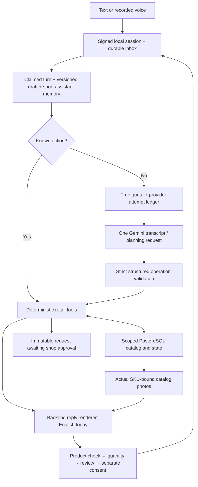

# ShopBot architecture — 3 October 2026

The running app is a local test channel over reusable retail services. `/native-test` uses a guarded free-only Gemini planning adapter; the original mock simulator remains separate. Actual WhatsApp delivery is not connected.

## Implemented boundaries

The trusted channel owns actor/store scope and current question/review bindings. The model proposes typed queries, quantities and operations; it cannot supply prices, images, stock assurances, pack conversions, acceptance or final submission authority. Invalid output applies no changes. Atomic tool batches, optimistic versions, idempotency receipts, current-photo identity checks and separate final consent protect orders. Submitted snapshots are immutable; a conversation currently permits one submitted request.

Catalog hierarchy uses `catalog_profiles`, `catalog_nodes` and product family/brand/specification/keyword metadata. Indexed store-scoped retrieval is bounded to 120 candidates; discovery returns at most three photos. The model receives a bounded map/sample and actual search observations. Product checks fit at most three groups and ten cards per local reply envelope. Refinement and choice callbacks can use zero inference.

Voice recording is explicit, previewed before upload and limited to 30 seconds. FFmpeg validates bytes and produces mono 16 kHz WAV. Audio bytes/hash/duration/source version are stored in scoped `voice_media`, separate from message JSON. One free-only planning call transcribes and extracts shopping intent. Playback uses the signed session. Audio cannot approve products or submit an order.

The quota ledger records every attempted live invocation, with no automatic retry or paid fallback. Current configured project limits are three calls/minute, 15-second spacing and 100/day. Message effects, outbound payload and processed marker commit together after rechecking the claim lease and source version. An external delivery outbox and webhook verification remain future work.

## Current language and catalog gaps

Source JSON contains Tamil names and aliases; aliases are searchable, but localized display names and a persisted reply-language preference are not yet implemented. Tamil vowel signs are now preserved by normalization. English and Tamil synthetic live requests in the latest audit failed strict model-output validation; one Tanglish request preserved quantity and showed actual photos but replied in English. Offline test passes do not establish multilingual conversation quality.

Demo product facts/stock/technical claims are unverified. JSON edits do not automatically overwrite existing SQL catalog rows. Authenticated merchant imports, reviewed translations/media metadata, object storage/retention, explicit new-request/amendment lifecycle and real WhatsApp integration remain implementation milestones.

See workspace `03-Output/013-catalog-storage-and-language-guide.md` for detailed message/storage maps, database fields, photo collection and the multilingual design. `03-Output/013-merchant-catalog-kit/` contains proposed review documents, not runtime imports. Verification: `03-Output/013-multilingual-verification.md`.
