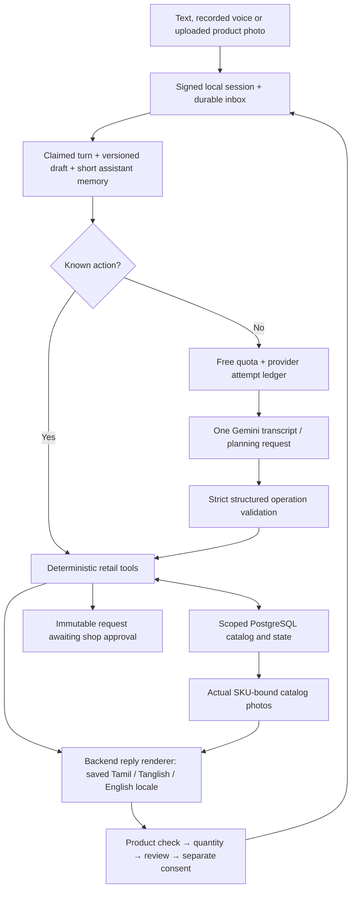

# ShopBot architecture — 3 October 2026

The running app is a local test channel over reusable retail services. `/native-test` uses a guarded free-only Gemini planning adapter; the original mock simulator remains separate. Actual WhatsApp delivery is not connected.

## Implemented boundaries

The trusted channel owns actor/store scope and current question/review bindings. The model proposes typed queries, quantities and operations; it cannot supply prices, images, stock assurances, pack conversions, acceptance or final submission authority. Invalid output applies no changes. Atomic tool batches, optimistic versions, idempotency receipts, current-photo identity checks and separate final consent protect orders. Submitted snapshots are immutable; a conversation currently permits one submitted request.

Catalog hierarchy uses `catalog_profiles`, `catalog_nodes` and product family/brand/specification/keyword metadata. Indexed store-scoped retrieval is bounded to 120 candidates; discovery returns at most three photos. The model receives a bounded map/sample and actual search observations. Product checks fit at most three groups and ten cards per local reply envelope. Refinement and choice callbacks can use zero inference.

Voice recording is explicit, previewed before upload and limited to 30 seconds. FFmpeg validates bytes and produces mono 16 kHz WAV. Audio bytes/hash/duration/source version are stored in scoped `voice_media`, separate from message JSON. One free-only planning call transcribes and extracts shopping intent. Playback uses the signed session. Audio cannot approve products or submit an order.

Customer image search now validates JPG/PNG/WebP uploads, normalizes a bounded JPEG without metadata and stores it in scoped `image_media`. A separate strict visual-search contract supplies catalog clues only; image-derived mutations are rejected independently by the runtime. Preview/cancel does not use inference; explicit send uses one guarded free attempt. Actual catalog facts/photos and customer choice remain authoritative. See `IMAGE-SEARCH.md`.

The quota ledger records every attempted live invocation, with no automatic retry or paid fallback. Current configured project limits are three calls/minute, 15-second spacing and 100/day. Message effects, outbound payload and processed marker commit together after rechecking the claim lease and source version. An external delivery outbox and webhook verification remain future work.

## Language and catalog boundaries

New native customer conversations persist Tamil as their default. Explicit text/button language requests switch to Tanglish or English without inference; a spoken request can switch only from its validated actual transcript. Language is separate from the order version, so switching keeps product and review consent bindings. The model receives the locale for bounded questions; backend templates own routine commerce copy. Unexpected-language or unsupported commerce questions fall back to backend wording. Localized product/family names are SQL metadata; SKUs, canonical names, measurements and integer-paise calculations remain authoritative.

Optional-null compatibility strips only explicitly named optional provider fields. Missing required values, extra fields, unknown kinds and invalid plans still fail the whole turn. `TAMIL-DEMO.md` describes the customer flow. Merchant review of dialect/terminology and fresh real Tamil voice recognition remain evaluation tasks; offline transcript fixtures do not establish acoustic quality.

Demo product facts/stock/technical claims are unverified. JSON edits do not automatically overwrite existing SQL catalog rows. Authenticated merchant imports, reviewed translations/media metadata, object storage/retention, explicit new-request/amendment lifecycle and real WhatsApp integration remain implementation milestones.

See workspace `03-Output/013-catalog-storage-and-language-guide.md` for detailed message/storage maps, database fields, photo collection and the multilingual design. `03-Output/013-merchant-catalog-kit/` contains proposed review documents, not runtime imports. Verification: `03-Output/013-multilingual-verification.md`.
