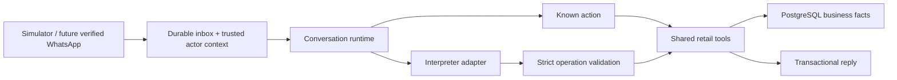

# Reusable agent tool core

2 October 2026. Implemented locally; native adapter and spending guards are available for explicit evaluation. The simulator still uses mock interpretation.

## Boundaries

The channel adapter owns verified identity and current-question/review binding at ingress. The model's operation arguments contain no actor, store, staff role, payment status or confirmation authority. The local simulator supplies fixed synthetic identity; production channel verification is future work.

The interpreter proposes shopping operations only. It cannot submit an order. Deterministic confirmation handling supplies a trusted consentReviewId to the submission service. A queued yes is bound to the review visible when it arrived, so it cannot approve a later edited review. Candidate callbacks carry question/line IDs and are rejected when stale. Price-only requests cannot mutate a draft.

The services check scope, validate quantities, resolve catalog facts, preserve every unresolved line, enforce expected versions and apply operation batches under a transaction. A failure in a dependent operation rolls back all effects of that turn. Operation keys and canonical argument hashes prevent conflicting replay.

## Tools

| Tool | Purpose and guard |
| --- | --- |
| search_products | Public facts from the trusted store; no cost/margin fields |
| get_draft | Resolved and unresolved lines for the authorized conversation |
| apply_draft_changes | Add, set/remove, resolve line or pickup; expected version and atomic batch |
| preview_order | Refresh current facts, clarify unresolved lines or issue a complete expiring review |
| submit_order_request | Trusted consent plus matching current review/version/hash/expiry; recheck facts |
| get_order_status | Read this actor's request snapshot; currently awaiting shop approval |

Tools are internal services, not an unauthenticated public tool execution endpoint. Future native function-call/MCP/channel adapters must use this boundary. The current registry is customer-only; staff/payment/ready actions do not exist in it.

## Runtime and recovery

A conversation lock claims one inbound turn with a 30-second lease. Known buttons, review/status, exact confirmation and current candidate ordinals need zero interpretation calls. Other text uses a mock adapter outside the database lock, with a 10-second timeout and at most two persisted attempts per message. An attempt is recorded before invocation. Interrupted attempts count as unknown; validated output is reusable only at the same source version. Mock usage is null and provider cost is zero.

Finalization rechecks the claim token and draft version. Tool effects, outbound reply and processed inbox marker commit together. A worker that loses its lease discards its result. The durable inbox and pg-boss dispatcher recover pending/expired work. This proves local mutation/reply recovery; it does not promise exactly-once execution of an external provider or WhatsApp send.

## Order meaning

Review totals use authoritative price paise, at most three decimal quantity places and half-up rounding per line. Unit steps come from catalog metadata. Review expiry is 15 minutes. Unknown stock remains subject to shop approval. No draft or customer confirmation reserves stock.

Submission consumes the review and stores an immutable lines/total snapshot. Acceptance, payment and fulfillment start separately as awaiting_approval, not_requested and awaiting_approval. Shop approval, payment evidence and physical readiness require future authorized staff tools. Current demo conversations allow one submitted request; amendment/new-order lifecycle is deferred.

## Native provider milestone

The adapter interface accepts text/current state and returns unknown structured output, a truncation flag and usage. Every result passes the shared schema before use. A native Google adapter now implements the contract with priced reservations, unknown-cost holds and bounded SDK requests. It runs only through explicitly authorized local evaluation; live quality is still unverified. The simulator remains mock-only. See NATIVE-AI.md. The English mock recognizes limited patterns and is not evidence of real-model language quality.

Catalog search currently scans active public products in one store. Hardware fixtures and aliases live in profiles/seeding, outside the core. Grocery tests prove reuse and decimal units. The cleaned KSMC pack is optional onboarding input. Production auth, database policies, concurrency/scale evaluation and merchant onboarding remain required.
