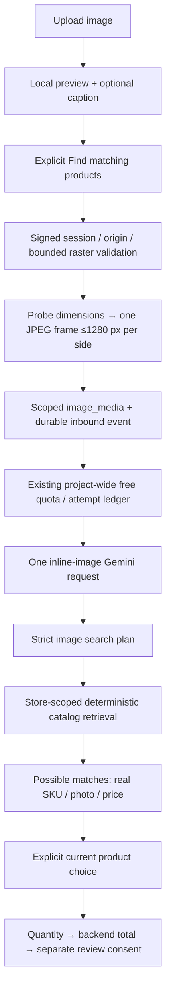

# Customer image search

Implemented locally on 3 October 2026 at `/native-test`.

## Try it

Refresh, choose **New chat**, then **Upload image** above Record voice. Choose a JPG, PNG or WebP product photo under 2 MB. Inspect the preview; optionally enter an English, Tamil or Tanglish caption. **Find matching products** shares the photo with the configured Google Gemini free-only adapter. Cancel photo discards the unsent preview. Uploading/previewing alone does not call the model.

The model proposes search clues. The backend retrieves actual catalog products and displays possible matches with their stored photos/prices. Choose the correct product and give its quantity; final order submission still needs a separate review confirmation. Image searches do not automatically add or approve products. Current backend reply templates remain English; a Tamil-caption image test is not proof of complete localized replies.

One image per search. Images of handwritten shopping lists, multi-product order extraction and image-based measurements are not implemented workflows. When a photo is unclear or unrelated, ask for a clearer product photo or description. Verify brand, size and type; visual resemblance is not product identity or compatibility evidence.

## Architecture

`POST /api/native-test/image` accepts a strict ID/MIME/base64/caption upload. Raw image events on `/events` are rejected; the runtime loads only scoped verified media. Magic bytes must match JPG/PNG/WebP. Files are bounded to 2 MB, 16 megapixels and 8192 pixels per original side. FFprobe and FFmpeg read stdin with only the pipe protocol, bounded output and five-second subprocess limits. Normalize to one JPEG frame and strip metadata; original files/EXIF are not retained. Store normalized JPEG/hash/dimensions/source version in PostgreSQL `image_media`. Do not log image/base64 contents.

`GET /api/native-test/image/:id` uses the signed conversation session, `private, no-store` and `nosniff`. Other conversations/actors cannot retrieve it. Duplicate event/photo IDs with identical content are idempotent; different content or captions cannot overwrite an existing event. Stale queued images fail before another provider request.

The image-only model contract has a nullable query, keywords and optional catalog family/department/brand/specification filters. Optional null fields normalize to omission. It has no order operations, prices, images or approval fields. A malformed plan is rejected. The runtime independently rejects any image-derived mutation, even from another interpreter. Product facts and callbacks remain backend-owned.

One free-tier call per submitted image search; SDK retry/automatic function calling are disabled. Native paid text billing does not authorize image inference. The existing project-wide three/minute, 15-second spacing and 100/day guards remain in force. There is no paid fallback. Bounded validation paths/codes (without provider content) are recorded for diagnosing schema failures.

Private binary object storage/retention and real WhatsApp image-webhook ingress remain future work. Current upload is the local harness for the reusable image/runtime services, not a WhatsApp delivery integration.

Provider reference: [Gemini image understanding](https://ai.google.dev/gemini-api/docs/image-understanding). See workspace `03-Output/014-image-upload-verification.md` for actual test results and limits.
