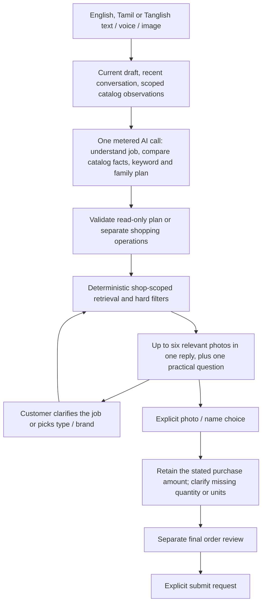

# Intent-led product discovery — 4 October 2026

The simulator controls are English. The customer's reply preference is independent: Tamil by default, Tanglish or English when explicitly selected/requested. English input never requires an English reply preference. Saved replies carry their own language so changing preference does not translate earlier product cards.

The customer may describe a job, use spelling variations, or ask about an unfamiliar product. One metered planning request reads current catalog facts and observations, identifies the intended job, expands compact English search keywords, compares observed items, and proposes real product families and an optional SKU ranking. SQL retrieval then rechecks the proposed products against the authorized shop, actual catalog identity, brand and specifications. A proposed SKU can reorder existing matching rows; it cannot inject a product into results. The model's useful job question accompanies the photos.

This is not a second model call reviewing freshly returned SQL rows. The model evaluates already-observed database facts during its one planning call; final retrieval rechecks those facts deterministically. A small shop with at most 40 products exposes all of them to the planner, fixing the previous 24-product blind spot in this 30-item demo. Larger stores retain a 24-item sample plus indexed, bounded search observations (at most 120 candidates per lookup). Further semantic retrieval for larger catalogs remains a future improvement.

Typical ambiguous requests show three to six relevant choices when the catalog has them. The listed PVC cutter is H19, so a specific pipe-cutter request can correctly show just one option. The system does not pad the carousel to meet a count. Multiple requested order lines still share a maximum of ten cards and three confirmation groups per reply; deferred groups appear after acceptance.

A workpiece dimension is distinct from a tool's size or capacity. “A tool for cutting a 25mm PVC pipe” must not become an exact cutter size filter of 25mm against a catalog label of 0–42mm. The model asks about the job and the backend preserves the catalog's actual specification. Neither a keyword nor an AI explanation proves technical compatibility. Merchant-verified material, tool compatibility and capacity metadata are still needed before giving confident fit advice.

The reported H19 failure was reproducible: the numeric regex backtracked on 42mm and could match only the first digit, excluding the real cutter and finding a reducer's alias. Sizes are now parsed in full; a unique actual SKU/name/alias uses its stored identity and specifications. Whole keyword phrases and verified families determine candidate scope, avoiding accidental matches on a shared word such as PVC. Hard requested product specifications and store boundaries remain enforced.

Paid inference stays disabled with a zero paid budget. Every real call goes through the existing project-wide quota ledger. Rechecks, current facet choices and photo selection use no extra AI. No automatic retry or model fallback is added. The local reply remains one envelope; real WhatsApp delivery, approved carousel templates and billing are a separate phase.

A live English job follow-up exposed a model decision that proposed an add_item with an unstated quantity of one. In photo-confirmation conversations, a single model add proposal during active read-only discovery now remains a suggestion. Its amount comes only from the previously remembered purchase request, never from that model default. The original provider response remains in the metered ledger; runtime effects apply the exploration guard. Explicit current photo callbacks enter the normal quantity/review flow. New multi-item shopping lists retain the existing grouped photo-confirmation process.
