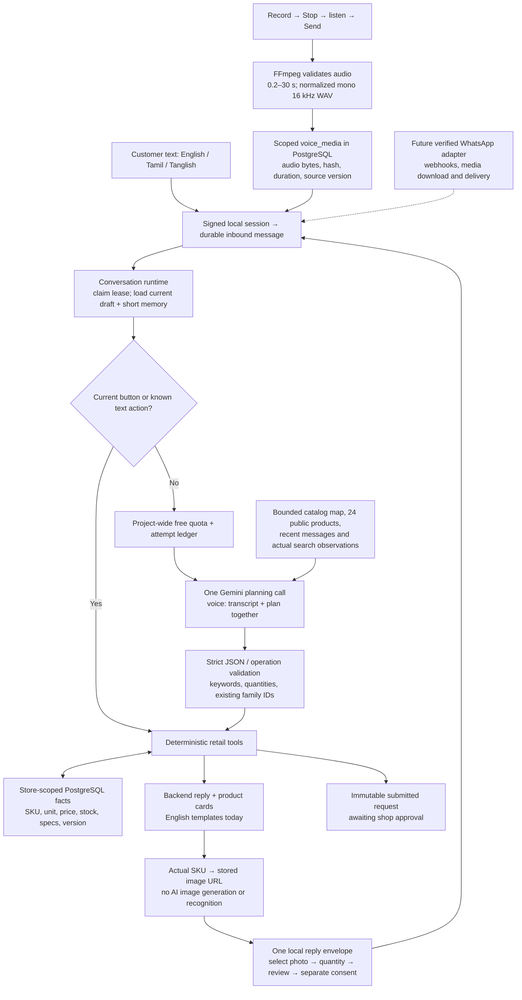
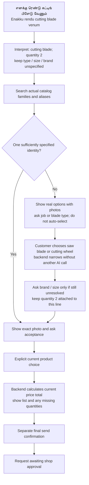
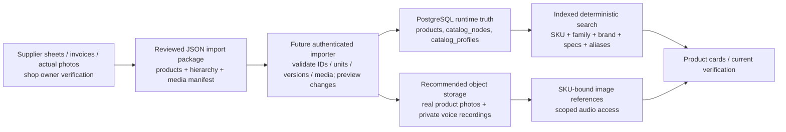

# ShopBot: catalog, storage and language map

3 October 2026. English, Tamil and Tanglish (Tamil written in English letters) are the intended modes. This guide distinguishes the running app from the recommended next implementation. Tanglish is a writing style, not a third spoken language.

## What the screenshot means

Your Tamil recording was transcribed into Tamil. In the existing browser it played successfully with a measured duration of 5.4 seconds and no media error. The initial 0:00 display came from `preload="none"`; the player now loads metadata. The English refusal came after a submitted ₹150 request: this conversation currently permits one submitted request and protects its snapshot. Use **New chat** for another order today. A future explicit **Start another request** flow should retain the previous request and status while opening a separate draft; an amendment must be separately approved by the shop.

Understanding a language, matching catalog entries and replying in that language are three separate capabilities. The English reply templates currently do not provide complete Tamil/Tanglish conversation support. `localNames.ta` exists in the source JSON, but the seed stores Tamil aliases rather than localized display names. The schema does not yet persist a preferred reply language. That is a real remaining milestone, not something fixed by uploading more pictures.

## Current message architecture

The AI interprets uncertain language; the backend checks and executes a plan. Neither can make an uncertain voice transcript certain. Customer photo selection and final submission consent remain the verification boundaries. A deterministic lookup is reproducible; it can still retrieve the wrong product if catalog data or the extracted intent is wrong.

## How an ambiguous blade request should work

Example Tamil copy for merchant review: **“கட்டிங் வீலா, ஹாக்சா பிளேடா வேண்டும்? படங்களைப் பார்த்து தேர்வு செய்யுங்கள். எதை வெட்டப் போகிறீர்கள்?”** Tanglish: **“Cutting wheel-aa, hacksaw blade-aa venum? Padangalai paathu choose pannunga. Ethai cut panna poringa?”** The current demo includes H14/H15 cutting wheels and H16 hacksaw blade; those source specifications are unverified. A pictured hacksaw blade is not proof it fits a wood-cutting machine. Store machine/tool compatibility only when verified, and retain an unmatched request when no compatible SKU exists.

Product checks currently fit at most three requested groups and ten cards in an envelope. Ten is a ceiling: show the smallest useful set, often two or three. Choose a family first when variants exceed that budget; preserve unresolved items for the next question. This local carousel preview does not establish real WhatsApp template eligibility, approval, layout or delivery cost.

## What you should collect per sellable variant

| Information | What to record | Why it matters |
|---|---|---|
| Identity | Stable store-scoped SKU, canonical name, active flag, version | One size/brand/pack variant must have one identity |
| Language | English name, Tamil name, Tanglish aliases, customer/shop spellings | Same SKU despite different language or misspelling |
| Hierarchy | Department ID → family ID; human labels and family aliases | A blade is not automatically one particular blade |
| Brand/model | Printed brand, model/part number, supplier reference | Avoid brand conflicts and lookalike packaging |
| Specifications | Verified dimensions with units; material; intended job; machine compatibility where known | Filter concrete requirements without guessing |
| Selling unit | Piece / box / bottle / roll etc.; quantity step; minimum quantity if applicable | Two boxes and two screws are different requests |
| Packaging | Pieces per pack and measured length only when verified; otherwise unknown | Never infer pack conversions from an image |
| Price | Current selling price as integer paise, currency, tax basis, effective date | AI never supplies the price or converts MRP into a selling price |
| Availability | Known count or unknown; source and last checked time | A missing listing is not proof of no stock |
| Photos | Real main photo per SKU; detail/label photo; identity and review metadata | Show the customer the actual variant |
| Review | Reviewed by, date, evidence/source, unresolved issues | Imported supplier/OCR/AI suggestions need human approval |

Example alias groups for one cutting-wheel family might include `cutting wheel`, `cutting disc`, `கட்டிங் வீல்`, `kating wheel`. Put broad `blade` aliases on the appropriate families rather than every product. Do not duplicate the broad term into incompatible products. Aliases improve recall; family/spec constraints and customer confirmation disambiguate it.

Keep specifications structured: `size: "4 inch"` is currently supported as a string value. Production typed dimensions such as diameter in mm, bore in mm, thickness in mm and compatibility should be added through a reviewed schema extension. Do not invent these values from a product photograph. Keep different selling variants separate even if they share a marketing picture.

## Where each kind of data belongs

**Today:** normalized catalog input is `02-Build/shopbot-ai/resources/catalog/ksmc-demo/catalog.json`; the tree is `catalog-map.json`; real demo JPEGs are in that folder's `images/`; products serve as `/demo-images/Hxx.jpg`. Runtime values are PostgreSQL rows. Editing JSON does not automatically update existing product rows: demo seeding uses `ON CONFLICT DO NOTHING` and intentionally preserves existing merchant edits.

**Today:** conversations, messages, draft state, assistant memory, order snapshots and provider/quota records are in PostgreSQL. Voice WAV bytes are also in PostgreSQL `voice_media`, scoped by store, conversation and actor. The mounted media directory is available but is not the current voice persistence path. There is no customer image-upload/image-recognition search feature.

**Next storage design:** keep SQL metadata and indexes authoritative. Put image/audio binaries in an object store; use immutable, versioned keys such as `stores/<store-id>/products/<sku>/<image-version>/main.jpg`. Keep `mediaId`, storage key, checksum, MIME type, byte size, dimensions, source, review state and timestamps in SQL. Bind photo identity changes to product versions so an old acceptance cannot accept a changed variant. Audio must use private, authorized access with a clear retention/deletion policy; don't place customer recordings in public product-photo folders. Set retention with the merchant before production; don't silently retain indefinitely or erase audit evidence.

JSON is an onboarding/export/review format, not a database that the model should open on each message. Store semantic aliases and translations as UTF-8 JSON fields/records. Do not put base64 images/audio inside product JSON, send the whole catalog to the model, or keep runtime prices in prompts. Avoid maintaining competing JSON and SQL prices without an import/version workflow.

## Photos to collect — and what to generate

For each actual SKU, photograph the entire product/package clearly, then its brand/model/size label. Use consistent framing, enough detail to distinguish variants and a plain background. A square or consistently cropped landscape preview is a practical preparation target, not a claim about WhatsApp's current upload limits. Keep the original high-resolution photograph plus a compressed display derivative and a checksum. Inspect the preview on a phone. Verify permission for supplier images and that packaging matches the item you sell.

Do **not** generate fictional product photos for product confirmation. An AI-created wheel can have the wrong bore, brand, thickness or packaging. AI can draft descriptions, aliases, translations and grouping suggestions for human review. Non-product category illustrations can be optional decoration, visibly distinct from SKU photos. No image generation is needed for the 30 demo products: use and verify the real photos already supplied.

## Efficient multilingual retrieval and replies

1. Preserve the original typed text/audio transcript. Normalize Unicode without stripping Tamil vowel signs. That stripping bug is fixed in this audit.
2. Curate multilingual names/aliases. Use one canonical product/family identity; translations must not become duplicate SKUs.
3. In one planning request, extract a compact canonical query, quantity, requested unit and only supplied specs. Do not translate an ambiguous `blade` into a specific cutting-wheel SKU. Omit uncertain filters.
4. Validate the proposed plan against the real store map; retrieve with exact SKU, family/brand/spec indexes, full-text and trigram/alias search. Current candidate ceiling is 120 and discovery returns at most three product suggestions.
5. Render actual catalog facts and SKU-bound photos. Ask one useful question; use current bound buttons for refinements and acceptance.
6. Add a persisted reply-language preference (`en`, `ta`, `ta-Latn`), a language override and reviewed message keys with placeholders. Prices/SKUs/units/order status remain backend values inserted into templates. This localization layer is proposed and not yet implemented.
7. Test native Tamil, Tanglish spelling variation, code-switching and real accents/noise separately. Transliteration spelling is variable; a three-case check is not language certification. Tanglish refers to text rendering, while mixed Tamil/English speech is its own audio case.

At this catalog size, curated aliases plus existing indexes are a sensible first retrieval layer. Embeddings or image recognition are not necessary to retrieve known SKU photos. If later evaluation shows missed job descriptions, add a bounded semantic candidate source, then apply the same hard catalog constraints and photo-confirmation gates. Never use embedding similarity as product identity or stock authority.

The runtime supports zero-model-call known actions, but not every Tamil/Tanglish short reply is covered by those English text recognizers. Product buttons remain an economical cross-language path. The model still sees a 24-product sample; future optimization should prioritize query-relevant observations plus a compact map, guided by actual recall measurements rather than deleting context blindly.

## Preparation kit and practical next steps

Open `013-merchant-catalog-kit/catalog-review.json`. There are 30 rows with their current demo reference and a blank merchant record. Start with the ten most commonly ordered variants. Confirm name, actual brand/size, selling unit, price/tax basis and real photo. Add phrases customers use in Tamil and Tanglish. Mark unknown stock/conversions as unknown. Do not promote the synthetic demo stock counts into production data.

The kit also includes `product-template.json`, `reply-copy-review.json` and `README.md`. These are **proposed review documents**, not accepted runtime import files. The next implementation should add validated merchant imports/media metadata and the language renderer before treating them as production configuration.

For voice acceptance testing, collect—with permission—short English, Tamil and mixed Tamil/English recordings: single clear SKU, vague blade, a multi-item list, a correction, uncertain quantity, background noise and a request after submission. Record expected words, quantities, units, acceptable candidate families and forbidden substitutions. Keep personal audio outside Git. Use offline scripted provider fixtures for transaction/consent tests and a small, ledgered free-tier sample for speech quality.

Before WhatsApp delivery: implement verified webhook identity, media retrieval, eligible approved message formats, idempotent outbox/status handling and authorized shop approval. Recheck Meta's current limits and category/account/market pricing at integration time. The app's ₹0.50/message figure is the owner's planning assumption, not a verified universal WhatsApp tariff. Batch clarification into a useful reply, cap cards at ten and avoid repeated image blasts; do not assume all interactive/template formats have identical rules.

Provider reference: [Google audio understanding](https://ai.google.dev/gemini-api/docs/audio) documents audio transcription/translation. This supports the chosen input architecture; it does not guarantee our application's Tamil reply quality or local accent accuracy. Actual audit results are in `013-multilingual-verification.md`.
