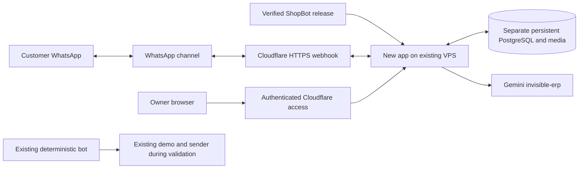

# ShopBot VPS migration plan — 4 October 2026

Deploy the current agent-based ShopBot on the Google Cloud VM, verify it privately, and then connect the intended WhatsApp sender through Cloudflare. The user selected a trial on the existing e2-micro. That private mock preview is now running and passed VPS smoke/restart checks; both older services were stopped and disabled, with their files and backups retained. See `018-vps-native-preview-progress.md` for executed work. Live AI, public access and WhatsApp remain subsequent work.

The selected trial uses a compiled native release and systemd, rather than the development Docker image. It keeps the 1 GB machine and 10 GB disk unchanged. The release is 63,492,702 bytes compressed and 208,451,704 bytes unpacked; the native Debian PostgreSQL/FFmpeg installation completed successfully. Google Cloud's ongoing compute allowance covers the eligible e2-micro; changing to e2-small/e2-medium would be paid even for an India/INR billing account. Remaining account credits and actual billing have not been audited. [Free-tier rules](https://docs.cloud.google.com/free/docs/free-cloud-features#free-tier-usage-limits), [billing currencies](https://docs.cloud.google.com/billing/docs/resources/currency).

The full account/project/resource inventory is saved locally at `secrets/deployment/cloud-inventory.md`, which is ignored by Git. Keep actual credentials in their existing approved secret stores.

## Verified setup and deployment implications

| Resource | Finding | Implication |
| --- | --- | --- |
| Google Cloud VPS | sago-counter-ksmc, e2-micro, Debian 13; private preview running with about 404 MiB available RAM and 1.8 GB free disk; swap in use | Keep the current capacity for this mock preview; measure real AI/media load before deciding on a paid upgrade |
| Previous application | ksmc-counter.service uses Python/uvicorn from /opt/ksmc-counter-assistant; now inactive/disabled; configured Meta/WhatsApp fields retained | Preserve its SQLite data and existing credentials; validate token validity and sender identity before reuse |
| Existing native test application | sago-agent-native.service uses Python/uvicorn from /opt/sago-agent-native; now inactive/disabled | This separate implementation is retained for rollback; the new Node/PostgreSQL ShopBot runs under /opt/shopbot-vps |
| Existing HTTPS route | demo.sagoautomation.tech → ksmc-retail tunnel → localhost:8097 on the VM; origin service now stopped | Tunnel configuration is retained for rollback; this hostname does not serve the new preview |
| Existing native test route | native-test.sagoautomation.tech → sago-agent-native-test tunnel → localhost:8099 | Four existing path rules target an older interface, not this build's /native-test and /api/native-test routes |
| Native tunnel replicas | One VPS connector and one desktop connector | Do not use it as a VPS-only endpoint without resolving which origin receives requests |
| Cloudflare routes | Both bot tunnels are locally managed | Review host configuration files; DNS changes alone do not update their ingress rules |
| Current repository | Private sagomedia/agent-native-whatsapp-bot; GitHub main is an older snapshot; deployed source frozen locally in e801589 | Use the verified release and preserve the shared workspace; no branch push was performed |
| Gemini | invisible-erp is on the free tier | Retain its persistent quota accounting and keep paid inference disabled |
| Current browser demo | Local-only host/origin checks and no owner login | First use an SSH tunnel; public hosting requires authenticated access and deliberate HTTPS/session handling |

Cloudflare Tunnel uses outbound connections, so the existing approach can publish selected HTTPS routes while the app/database stay on loopback. A static public IP is optional for this tunnel architecture. [Cloudflare Tunnel configuration](https://developers.cloudflare.com/tunnel/configuration/).

## Proposed order

### 1. Server inventory completed; finish WhatsApp identity and backup verification

Browser SSH inspection verified both Python services, ports, source directories, environment file locations, SQLite/media paths, remaining RAM/disk and both local tunnel configuration paths. Docker is not installed. The legacy environment contains Meta/WhatsApp Cloud credential fields; only field names and nonsecret mode flags were printed. Its credential validity, exact sender/app identity and backup restore capability remain to be verified before reuse.

The existing CLI key refresh was approved for one hour and applied, but the passphrase-protected private key could not authenticate noninteractively. The user then connected browser SSH successfully and the audit ran through that session. [Google SSH-in-browser](https://docs.cloud.google.com/compute/docs/connect/ssh-in-browser).

Verified credential locations: legacy /opt/ksmc-counter-assistant/.env; native test /etc/sago-agent-native.env. Legacy SQLite: /opt/ksmc-counter-assistant/data/enquiries.db. Native SQLite/media: /var/lib/sago-agent-native. Tunnel configs: /etc/cloudflared/config.yml and /etc/cloudflared-sago-agent-native/config.yml. Values stay in the existing approved stores.

Remaining deliverable: validate sender/token access and establish a restorable application backup. Observed pre-change SQLite copies and the GCP snapshot schedule have not been restore-tested.

### 2. Freeze a deployable source release

The newer Tamil and intent-discovery changes were copied into the managed checkout without altering the shared workspace or its Git configuration. The source and native deployment kit are frozen in commit `e801589` on `codex/vps-free-tier-preview`. The Node 22 build, four catalog tests and 109 integration tests passed. The exact portable release was also checked for startup, asynchronous synthetic replies and persistence after restart.

The selected release contains the official checksum-verified Node 22.22.1 runtime, compiled app/dashboard and production dependencies. It excludes .env, keys, private owner-only material, runtime media/databases and development dependencies. The VPS needs Debian PostgreSQL/FFmpeg, which are already installed. Docker installation is not part of this trial.

Deliverable completed: source commit, immutable archive and SHA-256, native install/smoke/rollback scripts, verified VPS upload and startup/restart checks.

### 3. Deploy a private VPS preview and switch the active services

Use the new `/opt/shopbot-vps` directory, separate PostgreSQL database and `/var/lib/shopbot-vps` media path, preserving both older services' files. Retain localhost bindings for app/PostgreSQL and a strong separate database credential. The native service has a 128 MB Node heap, a 384 MB service memory limit and reduced PostgreSQL memory settings. Build off the VPS. After readiness, synthetic reply and persistence checks pass on the VPS, stop and disable the two older services, then measure available RAM, swap, disk and actual service memory. Retain concrete rollback commands. A paid RAM upgrade remains an option only if measurements require it; no machine/disk resize or additional paid resource has been created.

Start with synthetic data. Use an SSH tunnel to localhost:3017 for the existing native-test UI. Keep its host/origin checks intact. Enable free inference only with the authorized project configuration; ALLOW_PAID_INFERENCE=false and AI_BUDGET_USD=0. A new independent database creates a separate quota ledger, so account for any other running applications using the same Gemini project.

Deliverable: healthy hosted app, successful Tamil/Tanglish text/photo/voice preview, explicit product/quantity/review consent and retained state after restart. Test migrations against disposable data; no mock reset or integration test should target the old merchant database.

### 4. Add the public channel and owner access

Choose an unused subdomain under sagoautomation.tech after reviewing current DNS/Access rules. Suggested names are shopbot-preview for authenticated owner access and shopbot-api for verified WhatsApp ingress; they are proposals, not existing routes.

Use a VPS-only tunnel/origin for the new service, or deliberately resolve the existing native tunnel's desktop/VPS replicas. Add authenticated HTTPS sessions and correct host/origin handling before sharing a browser preview. The Meta webhook needs its own publicly reachable verified endpoint and cannot be placed behind an interactive owner login. Publish only intended routes; keep the old demo and unrelated mail/lab records intact. Locally managed tunnel updates belong in the host configuration.

Deliverable: verified HTTPS endpoint that consistently reaches the intended VPS release, with separate owner access and webhook controls.

### 5. Connect WhatsApp, test, then switch deliberately

The legacy app has WhatsApp Cloud API configuration and a Meta Graph API sender. Validate its token, sender/app identifiers, permissions and webhook subscription before reusing authorized account resources. Place secrets directly in the approved server secret store; save only names/locations in deployment records.

Implement webhook challenge verification and raw-body signature checks, server-side customer/store identity, duplicate message handling, bounded media fetch, durable outbound delivery and delivery-status reconciliation. Connect these to the existing catalog/draft/consent services. The current repository does not yet provide that hosted channel. [Meta's archived SDK webhook reference](https://whatsapp.github.io/WhatsApp-Nodejs-SDK/api-reference/webhooks/start/) explains challenge/signature mechanics; use current platform documentation at implementation time rather than adopting the archived SDK.

Start with a test sender and explicitly authorized recipients. Verify text, Tamil/Tanglish, voice/photo, product choices, quantity correction, review/confirmation, retries, duplicate events and restart recovery. Recheck current messaging windows/templates/pricing for the actual sender; the local 50-paise planning estimate is not a confirmed tariff.

Before moving an existing sender, pause the old outbound consumer and switch webhook/routing in a controlled step so the same event does not cause two replies. Retain a concrete rollback to the old service/webhook, and reconcile events received during the switch.

Deliverable: one verified inbound-to-outbound WhatsApp conversation through the new app, with the old deployment retained for rollback.

## Intended architecture

## Deployment record

- Latest release source commit: `e801589`; package `preview-8f06fd2bcec5`, SHA-256 recorded in `018-vps-native-preview-progress.md`.
- Existing server services, source and data locations: verified in the private inventory. New native deployment is active under `/opt/shopbot-vps`, on loopback port 3017 with a separate PostgreSQL database. Both older apps are inactive/disabled, with their files retained.
- Credential store/file locations and required key names: verified; values remain private and token validity remains untested.
- Old Meta sender/app identifiers and webhook subscription: pending targeted account validation.
- Capacity decision: private mock preview running on unchanged e2-micro; after switching services, about 404 MiB RAM available and 1.8 GB disk free. App about 45 MiB and PostgreSQL about 60 MiB; production AI/media load remains untested.
- VPS-only tunnel, selected subdomain and access policy: pending implementation.
- Database/media backup: `/var/backups/shopbot-migration/20261004T065723Z`, five SQLite copies passed integrity checks; full restore drill pending. Native rollback script prepared.
- Hosted application: readiness, dashboard, async synthetic reply and app restart persistence passed. Live AI / WhatsApp end-to-end verification pending.

The initial inventory was read-only apart from the approved one-hour SSH key refresh. During user-authorized deployment, private legacy backups were created and verified, Debian PostgreSQL/FFmpeg packages were installed and the native preview was uploaded, installed and verified. Both older apps are now stopped/disabled. No Docker installation, machine/disk resize, DNS/tunnel change, API token rotation or customer message has occurred.

At the user's request, Google Cloud MCP/direct access replaced the browser transfer workflow. The official Compute Engine remote MCP and Google's local gcloud MCP both returned the VM successfully using the existing account. The local `google-cloud` MCP is configured in Codex; direct SSH/SCP completed deployment because gcloud MCP blocks SSH commands. No IAM or cloud resource change was made while connecting MCP. A temporary loopback-only SSH tunnel exposes the private VPS preview locally at `http://127.0.0.1:3018/` for at most one hour.
