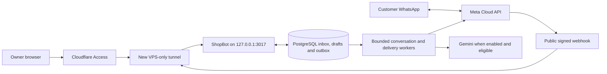

# WhatsApp and Cloudflare connection plan

Prepared 4 October 2026 by Astra, high effort. Planning only; no application, server, account, DNS, subscription or messaging changes were made for this report.

**Recommendation:** keep the existing VPS, give the owner a protected dashboard, and connect Meta through a separate public webhook on a new VPS-only tunnel. Reuse the tested retail engine. Add the missing customer identity, channel delivery and owner controls before connecting a real sender. Start with one merchant, one verified sender and one explicitly authorized test recipient.

## What is ready, and what still needs building

The deployed native release `preview-8f06fd2bcec5` runs on loopback port 3017 with a separate PostgreSQL database. The recorded Node 22 build, four catalog tests, 109 regression tests and VPS readiness/restart checks passed. It currently uses mock mode, no Gemini key, AI disabled and zero paid budget. These are prior deployment results, not tests rerun for this plan. See [deployment evidence](/home/gk-pc/.codex/worktrees/a43c/2026-10-agent-native-whatsapp-bot/03-Output/018-vps-native-preview-progress.md).

Source inspection establishes these boundaries:

| Component | Existing behavior | Connection work |
| --- | --- | --- |
| HTTP/dashboard | `http/app.ts` serves the React dashboard and unauthenticated simulator only in mock mode; live mode currently exposes health routes | Add an authenticated owner surface and explicit channel configuration; setting `APP_MODE=live` alone will not launch the product |
| Native AI preview | `http/native-test.ts` permits only localhost and matching HTTP Origin, uses a process-random signed test cookie, and calls AI/media processing inside requests | Preserve local-test restrictions; build a separate hosted, authorized preview/session path with queued processing |
| Retail core | Scoped catalog/draft tools, product choices, quantity correction, language preference, versioned review, explicit consent, immutable submitted request | Reuse these services behind a verified channel identity; retain all consent checks |
| Background runtime | Durable inbound rows, leases, receipts and pg-boss exist, but `jobs/simulator.ts` drains the fixed mock conversation | Add scheduling across real conversations with bounded concurrency and restart recovery |
| Outbound replies | `runtime/conversation.ts` inserts generated output with status `sent`; `services/whatsapp-plan.ts` explicitly contains no sender | Create a durable outbox and distinct provider-accepted/delivered/failed states; current `sent` is not delivery evidence |
| Owner workflow | Current UI is a customer simulator; `services/context.ts` rejects staff use of customer tools | Add scoped owner authorization and dedicated owner endpoints, rather than impersonating a customer |
| Media | Validated images and recorded audio are supported; normalized bytes are persisted in PostgreSQL | Add authenticated Meta download/upload adapters, retention and size-aware handling |

The old VPS services are **already stopped and disabled**. Their Cloudflare origins on ports 8097/8099 can therefore fail. The old `native-test` tunnel still has both desktop and VPS connectors, so a successful request there does not establish VPS availability. Neither existing hostname should be repointed casually. Files/backups remain, but sender validity, current subscriptions and whether real customers depend on them are unverified.

## Proposed network and authentication

These are proposed names, not created or confirmed-unused resources. Check exact names, wildcard DNS and Access policies before creation.

| Proposed endpoint | Audience and allowed surface | Protection |
| --- | --- | --- |
| `shopbot-preview.sagoautomation.tech` | Owner dashboard, `/api/owner/*`, authenticated synthetic preview and scoped private media | Cloudflare Access on the entire hostname; server authorization on every API/media request |
| `shopbot-api.sagoautomation.tech/webhooks/whatsapp` | Meta verification GET and signed event POST only | Public HTTPS, raw-body signature verification, bounded request parsing and durable event storage |
| Everything else on the webhook hostname | No dashboard, simulator, uploads, health details or generic API | 404; unsupported webhook methods rejected |

Use one new named, locally managed tunnel, proposed `shopbot-vps`, with credentials installed only on the VPS and a dedicated systemd unit. Explicit hostname/path rules precede a final 404 rule. Keep Node and PostgreSQL on loopback. No Worker, Pages deployment, public app port or database exposure is needed. Outbound Meta calls leave the VPS directly; the tunnel receives inbound traffic. Tunnel ingress supports ordered hostname/path rules and validation commands. [Cloudflare configuration reference](https://developers.cloudflare.com/cloudflare-one/networks/connectors/cloudflare-tunnel/do-more-with-tunnels/local-management/configuration-file/).

Create the Access application and exact owner allowlist before publishing its DNS. Prefer the existing identity provider with MFA; use exact-email OTP only as a deliberate initial alternative. Proposed Access session: eight hours. Enable per-owner-route `originRequest.access.required`, team name and application audience. Cloudflared can validate the Access JWT before forwarding; additionally validate signature, issuer, audience and expiry in the owner API and map the verified subject to a server-side merchant membership. Never trust an email header alone. These are proposed application controls using Cloudflare's documented validation mechanisms. [Protect with Access](https://developers.cloudflare.com/cloudflare-one/networks/connectors/cloudflare-tunnel/configure-tunnels/origin-parameters/#access), [application JWT](https://developers.cloudflare.com/cloudflare-one/access-controls/applications/http-apps/authorization-cookie/application-token/).

Keep the two hostnames separate in application routing as well as tunnel rules. Preserve the intended Host; allow only explicitly configured HTTPS origins for owner mutations, with CSRF protection. Trust forwarded protocol information only from the loopback proxy. If an additional app session is needed, use a persistent server-side session or protected stable signing key, with `Secure`, `HttpOnly`, host-only cookies and bounded expiry. Restart must not silently transfer or lose identity. Private pages/media use `Cache-Control: private, no-store`; no broad cross-origin access.

The webhook host must not inherit interactive Access or browser challenges. Exempt only its exact route from incompatible challenges after testing; retain signature checks and sensible abuse limits. Do not rewrite Host to localhost to evade the current preview guards. Keep existing mail, lab and legacy tunnel records intact while validating the new tunnel.

## WhatsApp account and number decision

First inspect the existing Meta setup read-only. The legacy environment contains credential fields, but that does not prove a working or intended sender. Record sanitized results privately: owning business, app, WABA, registered number/display name, test-versus-production status, token validity/expiry/permissions, assigned assets, app mode, sender quality/limits, subscribed apps and effective callback URL/fields. Check whether a callback change affects other numbers in the same app/WABA. Use tokens in authenticated server-side calls without printing them or including them in shell history/logged URLs.

Reuse the existing authorized Cloud API sender if those checks identify the intended business and compatible setup. A deployment change by itself does not require another phone number or re-registration. For a new dedicated number, separately complete business setup, ownership verification, display-name requirements and registration/two-step verification using the selected Meta flow. Meta's official collection documents token types, number registration and verification; production should use an appropriately scoped system-user token, with its actual expiry checked rather than assuming permanence. [Meta Cloud API collection](https://www.postman.com/meta/whatsapp-business-platform/collection/wlk6lh4/whatsapp-cloud-api?action=share&creator=22794852).

If the chosen number must continue in the WhatsApp Business mobile app, assess Meta's **coexistence onboarding** before choosing registration or migration. Its current eligibility and availability for this account are unverified. The official [Business app onboarding documentation](https://developers.facebook.com/documentation/business-messaging/whatsapp/embedded-signup/onboarding-business-app-users) returned HTTP 429 during research, so this plan does not promise coexistence or rely on third-party eligibility claims. Do not delete/deregister the mobile account as a setup shortcut. If coexistence is eligible, also design for app-originated message echoes and human takeover. Multi-merchant Embedded Signup is a later project; Meta documents it as an onboarding flow for providers/partners. [Official Embedded Signup collection](https://www.postman.com/meta/whatsapp-business-platform/documentation/du6gzjv/embedded-signup).

Store the selected credentials directly in the restricted server secret store. Separate the verification token, app secret and API access token. Show only connection state/expiry in the dashboard. Add expiry reminders, an auditable rotation runbook and a pause-on-authentication-failure behavior; some long-lived tokens can still be revoked. Validate a replacement before retiring the old token. Pin a supported Graph API version after checking the account's current version; do not copy a historical version blindly.

## Channel behavior to implement

1. **Verify and persist before acknowledgment.** GET returns `hub.challenge` only for the expected subscribe mode and verification token. POST verifies `X-Hub-Signature-256` with HMAC-SHA256 over the exact raw body using the app secret and constant-time comparison, before accepting parsed events. Handle all batched entries/messages/statuses, not only the first. Return 200 after durable commit; return a retryable failure if storage is unavailable. No AI, FFmpeg or message sending occurs in the webhook request. Meta's [webhook verification reference](https://whatsapp.github.io/WhatsApp-Nodejs-SDK/api-reference/webhooks/start/) describes challenge/signature mechanics; its SDK is archived and should not be adopted as the runtime dependency. Current platform pages were rate-limited during research and must be rechecked during implementation.
2. **Derive identity on the server.** Map the verified receiving phone-number asset to a merchant channel, then the webhook sender identity to a merchant-scoped customer. Treat display names/text as untrusted. Keep provider message IDs as strings mapped to internal UUIDs; deduplicate with a unique channel-plus-provider-message key. Reject/quarantine unknown business assets. Neither browser IDs nor model output can select another store/customer.
3. **Reuse the retail transaction.** Generalize ingest without using the simulator's fixed identity. Commit interpreted effects and the intended outbox reply together. Queue workers with per-conversation ordering/leases, an initial single AI/media job at a time and fair scheduling. Separate receive, process, AI and send switches; start with sending disabled. Quota exhaustion keeps the draft and offers deterministic choices or human help.
4. **Bind customer actions to what was actually shown.** Convert interactive replies into opaque, expiring server-side callback references scoped to customer, conversation, displayed product/review, version and outbound message. Ordinary text is never a client-supplied privileged event. Do not treat a generic “yes” as consent to a newer review that was generated but not delivered; use reply context/current verified prompt or request confirmation again. Preserve separate product, quantity and final-order consent. Add an explicit “new request” lifecycle after submission while retaining the immutable old request; the current demo otherwise freezes that conversation.
5. **Deliver through an outbox.** Unique logical reply/action keys prevent duplicate enqueue. Track queued, sending, provider-accepted, delivered, read, failed and unknown outcomes with attempt records and provider IDs. HTTP acceptance is not customer delivery. Retry only classified safe failures, with bounds/backoff and recipient/window rechecks. A timeout after transmission may mean Meta accepted the message: mark unknown and reconcile through status events/operator review rather than blind retry. Do not claim exactly-once network delivery or assume an undocumented provider idempotency key.
6. **Reconcile status events independently.** Persist deduplicated events, tolerate out-of-order delivery/read callbacks, retain failures and correlate callbacks that arrive before the send response is committed. Never downgrade read to sent. Unmatched or ambiguous outcomes appear in the owner queue; no assumed universal “fetch missing message” endpoint. Status events must not produce chat replies.
7. **Respect the current customer-service window.** Track the timestamp of the last verified customer message, not local retry time. Outside the 24-hour window, use only an eligible approved template, with appropriate opt-in and budget; MVP should block such sends and flag owner action. Human sends obey the same rule. Provide visible human escalation and honor opt-out. [WhatsApp messaging policy](https://whatsappbusiness.com/policy/).

For the first WhatsApp UI, render Tamil/Tanglish/English text, a small set of reply buttons and list choices. The current browser's six-photo cards are not evidence of a WhatsApp carousel capability. Without a linked, validated Meta catalog, show named choices first and one selected product photo/confirmation when needed; do not silently lose the product-check step. Upload approved product images to Meta and send by media ID, avoiding public customer-media URLs. Rich product/catalog messages and paid template carousels come later after actual eligibility and cost checks.

Inbound media downloads use the verified media ID and scoped phone-number check. Meta's media URL requires authentication and lasts five minutes; obtain a fresh URL if necessary. Fetch only server-obtained HTTPS media URLs, block private/local destinations and uncontrolled redirects, cap streaming bytes/time, verify actual MIME and discard temporary files. Start with current application limits: images at most 2 MiB; audio at most 1 MiB and 30 seconds. Reject larger/unsupported items with a helpful typed alternative; do not infer that Meta's larger limits are safe on this VPS. One bounded decoder at a time. [Meta media retrieval](https://www.postman.com/meta/whatsapp-business-platform/request/fpj02x0/retrieve-media-url).

## First owner dashboard

Build three small views using the existing React/Fastify app:

| View | First usable release |
| --- | --- |
| Conversations | Recent conversations, unread/needs-help state, language, conversation and delivery timeline, current draft/review, scoped media, explicit takeover/resume and manual reply |
| Requests | Customer-confirmed, shop-pending requests with immutable lines/totals; dedicated staff accept/reject actions with audit record; clear payment/readiness state |
| Connection and usage | Sender masked for routine display, webhook/tunnel/app status, last inbound/status event, backlog/failed/unknown sends, token expiry, AI disabled/free state and quota, pause automation/sending |

An initial protected preview can demonstrate these with synthetic fixtures before Meta is connected, clearly labeled **Demo**. Real merchant records need a separate live store/channel mapping and a distinct view. Never reinterpret the fixed demo store as a real merchant. Do not expose development tools, reset endpoints, credentials or owner-only catalog financials.

Taking over a conversation must atomically stop new bot work and cancel unsent automatic replies, including a send-time recheck for already queued jobs. A send already accepted by Meta cannot be recalled by the toggle. Manual replies go through the same outbox; resuming is explicit. Shop acceptance requires a dedicated staff transaction, not a model instruction; it does not imply payment, stock reservation or readiness.

Defer payments/UPI verification, POS/stock synchronization, campaign broadcasting, automatic ready-for-pickup claims, multi-merchant onboarding, catalog administration and a broad analytics platform. Use the existing catalog import process with merchant review for the pilot. A production merchant must verify product names, units, prices, media rights and any restricted items before loading its catalog.

## AI, privacy and free-tier limits

Tamil/Tanglish/English preferences, photo suggestions and recorded-voice planning exist locally. The new VPS has not run those live paths. Enable its existing Google adapter only after key placement, provider/account checks and a synthetic VPS test; `ALLOW_LOCAL_AI_TEST` is a development gate, not the real WhatsApp worker configuration. Start with the deployed model contract and one attempt per message, preserving no automatic fallback/repair calls. Have the merchant review Tamil wording; freshly test actual voice behavior before advertising it.

**Verified provider rule:** Google's terms say Unpaid Services may use input/output for improvement and human review and instruct users not to submit sensitive, confidential or personal information. For Gemini API, the Paid Services classification depends on accessing it through a project linked to an active billing account; AI Studio has a separate account-level rule. EEA/Switzerland/UK have a stated data-use exception. **Unknown here:** the actual API project's billing linkage and applicable classification were not audited; a displayed free quota alone does not settle it. **Proposed pilot:** synthetic/nonpersonal prompts until that check is complete; arbitrary customer voice/photos must not automatically flow to an unverified free-service data path. Customer consent alone does not override provider terms. [Gemini API terms, Unpaid and Paid Services](https://ai.google.dev/gemini-api/terms).

The merchant owns customer service and catalog decisions; the system operator administers the service; an Access login grants only its explicit merchant membership. WhatsApp identity is not owner authorization. Minimize AI context, exclude phone identities/credentials/margins, redact logs and provide a customer privacy notice and deletion/retention process. Proposed pilot retention is seven days for raw media and 30 days for diagnostic webhook payloads, with longer-lived minimal idempotency/status records and separately agreed order retention. Implement deletion in PostgreSQL as well as the media directory: current normalized media is in database rows. Backups need matching expiry rules.

| Cost area | Practical constraint |
| --- | --- |
| Cloudflare | Target Tunnel + Access Free; Cloudflare documents free use for up to 50 users. Verify this account's Zero Trust enrollment and plan: the DNS zone's Free plan is a separate fact. No paid add-ons in this plan. [Cloudflare reference](https://developers.cloudflare.com/reference-architecture/architectures/sase/) |
| WhatsApp | Meta charges by delivered message category/recipient market; service replies during the open 24-hour window are free. Restrict the pilot to those replies. The app's ₹0.50 planning figure is not a verified tariff or invoice; paid templates remain blocked until the applicable rate card/currency/taxes and ceiling are selected. [Meta pricing](https://whatsappbusiness.com/products/platform-pricing/) |
| Gemini | Observed account allowance: 15 RPM / 250K TPM / 500 RPD; local guard: 3 RPM, at least 15 seconds apart, 100/day. Limits apply across the project, not API keys. Separate desktop/VPS databases have separate ledgers: stop other pilot consumers or establish shared accounting. These are request limits, not a customer capacity promise. [Google quota rules](https://ai.google.dev/gemini-api/docs/rate-limits) |
| VPS | Existing eligible e2-micro region and standard disk fit the published compute allowance, subject to aggregate usage. e2-small/e2-medium are paid changes. Current public IPv4 has a listed standard-VM rate of $0.005/hour, roughly $3.60 for 720 hours before allowance/credits/taxes; billed INR depends on the applicable SKU. Total ₹0 is not established. Egress, snapshots and backup storage can also cost. [Compute allowance](https://docs.cloud.google.com/free/docs/free-cloud-features#compute), [IPv4 pricing](https://cloud.google.com/vpc/network-pricing#ipaddress) |

Keep paid inference false and budget zero. This application setting cannot guarantee free provider billing if account billing changes. Do not enable billing or resize as a side effect of connecting services. Cloudflare Tunnel still needs outbound Internet connectivity; removing the public IP without an egress design can break it and is not a free-cost shortcut.

## Execution order and gates

| Phase | Concrete work | Exit requirement |
| --- | --- | --- |
| 0. Validate continuity | Read current sender/subscriptions and last delivery evidence; audit both old origins/desktop connector; check account billing classification and Access plan; inventory backups | Know whether tests or actual customers are affected. If production traffic was interrupted, prioritize a reviewed continuity recovery before new-feature rollout |
| 1. Build privately | Hosted owner auth, scoped dashboard, real customer/channel mapping, live-mode startup, inbox/outbox/workers, callbacks, takeover, migration and send-disable controls | Node 22 build/catalog tests/current regression suite plus new channel/security/crash tests pass on disposable data |
| 2. Publish owner preview | Add VPS-only tunnel, owner Access policy and proposed owner DNS after name checks; deploy immutable candidate; verify host/origin/session behavior | Allowed owner can use synthetic preview from another network; unauthorized access and cross-store attempts fail; restart works; no sends enabled |
| 3. Connect receive-only channel | Publish exact webhook route; verify Meta challenge; enable appropriate `messages` subscription and WABA app subscription only after checking their scope; collect authenticated test events | Correct sender maps to correct store, duplicates stay single, statuses persist, receive path survives restart, backlog is visible, sending stays disabled |
| 4. Run authorized test | User identifies one recipient and authorizes the test conversation; allowlist it; user initiates inbound chat; enable bounded service-window replies | Text/language, photo/voice where eligible, product choice, correction, final review, one synthetic request, delivery status and human takeover all pass |
| 5. Limited merchant launch | Reviewed real catalog, privacy/provider decision, working backup/restore, small pilot cap, operator availability and event reconciliation | No unresolved duplicate/unknown sends, capacity acceptable and a measured rollback rehearsal completed |

Phases 1–2 can proceed with mocks while account validation is incomplete. Steps requiring a production callback switch or real recipient remain gated on the actual sender and recipient decisions. Registration/App Review/coexistence may introduce external waiting time; do not promise a fixed launch date before Phase 0.

**Preserve events during preparation.** Record the cutover time, old callback configuration and last known event identifiers without exporting customer content into this report. If actual customers currently use a stopped origin, do not leave it knowingly broken while building: select a controlled restoration of the verified old receiver, or a verified durable receive-only bridge, before continuing. The legacy configuration had live test sending enabled, so starting it blindly can emit messages. Keep only one active outbound owner. An app-level subscription change can affect multiple numbers; prefer a documented narrower override only after verifying support. Meta retry/history availability is not a backup guarantee; the current retry duration was not verified from accessible current docs. Reconcile stored old/new events and report unrecoverable gaps rather than promising automatic backfill.

## Acceptance tests and rollback boundaries

Use synthetic fixtures and a mocked Graph transport for routine tests. Never run reset or test migrations against a merchant database. Proposed additional checks:

- **Routing/auth:** `cloudflared tunnel ingress validate` and URL rule checks with the exact new config; webhook path only on API host; no accidental Access challenge there; denied owner login, missing/expired/wrong-audience JWT, forged identity header, cross-origin mutation, cross-merchant media, logout/revocation, and session after app restart. Confirm the new tunnel has only the intended VPS connector.
- **Ingress:** correct/wrong challenge; missing/tampered signature including whitespace changes; oversized/malformed/batched payload; unknown sender asset; duplicate/reordered events; DB outage before acknowledgment. Target webhook acknowledgment p95 below one second at pilot load, independent of AI latency.
- **Recovery:** crash after durable receive, during processing, after outbox commit, after provider acceptance before local save, and after callback arrival before correlation. Verify one business mutation/request, deduplicated outbox intent and an explicit unknown-send outcome when delivery cannot be proven.
- **Conversation:** two customers concurrently, stale/cross-customer callbacks, old “yes” after an undelivered newer review, price/quantity change, repeated confirmation, language switching, opt-out, takeover racing a queued reply, new request after submission and closed-window blocking.
- **Media/provider:** expired media URL, malicious redirect, incorrect MIME, corrupt/oversized/silent audio, decoder timeout, quota exhaustion, 429/cooldown and token revocation. No automatic spending fallback; no customer media exposed on the public host.
- **Capacity/recovery evidence:** one decoder/AI worker, several queued chats and an owner session; measure Node/FFmpeg/PostgreSQL/tunnel memory, swap activity, disk and backlog for a 30-minute synthetic soak plus a monitored pilot. No OOM/restart loop or unbounded queue growth. Proposed pause threshold: disk below 1 GiB or sustained available RAM below 150 MiB. Current mock-only figures—404 MiB available RAM, 106 MiB swap used, 1.8 GB free disk—do not certify live capacity.
- **Backups:** restore a new PostgreSQL dump plus catalog/media/config manifest into an isolated database and exercise a conversation/outbox with sends disabled. Five legacy SQLite copies passed integrity checks, but the full restore drill remains outstanding. Keep an encrypted off-VM backup in an approved destination before real orders; do not silently buy storage. Measure actual restore time and data-loss window.

Rollback has three distinct boundaries. Before Meta subscription changes, withdraw only the new routes or restore the previous new-app release; the old deployment remains untouched. After receiving events, pause processing/sending but retain durable reception and databases while fixing the candidate. After sends or orders exist, first disable the new sender, record accepted/unknown outcomes and reconcile them before restoring any older consumer. Code rollback cannot undo delivered messages or safely erase newer orders.

The existing command `sudo bash /opt/shopbot-vps/current/deploy/rollback.sh` stops the new app and starts both older services. It **does not** restore Meta subscriptions, new DNS/Access settings or migrate PostgreSQL data into legacy SQLite, and can re-enable legacy outbound behavior. Extend the deployment runbook with explicit routing/subscription and sender reconciliation steps before using it after WhatsApp cutover. Prefer additive database migrations so a preceding compatible release can still read retained data.

Only a few user choices should remain after the read-only audit: confirm the intended merchant/sender if more than one is viable; supply the exact owner login allowlist; identify and authorize the first test recipient; and choose a production AI/privacy or paid-budget option only if the verified account requires it. Proposed names, small dashboard scope, one-worker limits and synthetic-first testing can be implementation defaults. This report itself authorizes no live send or account change.
