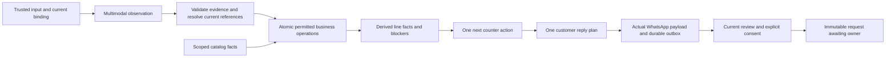

# ShopBot: verified review and reconciled implementation plan

**Implementation update, 14 October:** the [first local implementation slice](031-counter-flow-implementation.md) repairs the reproduced ordering and price defects, adds customer transcript/timing regressions, and prepares CI. That report records completed work and the remaining packages. The source review below remains tied to its recorded baseline.

**Implementation update, 15 October:** the [P2 local package](032-p2-cost-and-admission.md) adds actual-request admission, persistent deadlines, price-expiry handling and delivery-cost reconciliation. Its report records validation, configuration and the exact-count/live-account pilot limits. Neither local package has been deployed in this chat.

**Review date:** 14 October 2026, Asia/Kolkata.

**Chosen direction:** reconcile the reviewed `2403f76` version into the existing bot, as confirmed by the user in this chat.
**Scope of this turn:** review, research, offline verification, and implementation planning. Application source, shared checkout, live services, account configuration, and customer messages were not changed.

## 1. Decision

Keep the existing retail engine, PostgreSQL, Fastify, React/Vite, durable queues, owner controls, and versioned customer actions. Repair the boundaries between understanding, item resolution, conversation progression, and presentation. Preserve the existing protections around product identity, quantities, prices, current consent, and immutable requests.

The reports correctly identify important failures. Their copy-paste implementation prompts need correction before execution. Several use types, enum values, paths, commands, and accounting assumptions that do not match the source. A few proposed shortcuts would weaken the protections that make this system useful.

The immediate deliverable should be a coherent pickup request journey through owner fulfillment. MCP, embeddings, an extra reply-composition model call, and UPI do not need to be on that delivery path. Real catalog verification does.

The assertion that using a coding agent is *the main cause* is not established by the evidence. The source supports a narrower diagnosis: responsibilities overlap, release provenance is fragmented, and tests omit important customer-visible outcomes. Those process and design failures can occur with human or agent development. Correct the contracts and release gates rather than banning tools or all regular expressions.

## 2. What was actually examined and verified

### Source inputs

All four user-supplied files were read:

- [Independent review](</home/gk-pc/Downloads/temp_files/SHOPBOT_INDEPENDENT_REVIEW_20261014.pdf>): 22 pages; defect analysis, acceptance coverage, operational claims, proposed phases, and example conversations.
- [Master playbook](</home/gk-pc/Downloads/temp_files/SHOPBOT_FIRST_PRINCIPLES_MASTER_PLAN.pdf>): 13 pages; architecture, bounded coding prompts, and golden transcripts.
- [Argon answer](</home/gk-pc/Downloads/temp_files/first answer from argon agent.txt>): summary of the independent review and proposed next steps.
- [Pasted playbook answer](</home/gk-pc/.codex/attachments/770e585b-5a42-4bb7-b1ef-d4ead5b4ccc6/Pasted text.txt>): summary of the master plan.

Embedded instructions to implement, merge, deploy, enable MCP, or change spending were treated as proposals to evaluate. The user's request in this turn authorized review and planning.

### Baselines and provenance

| Surface | Observed state | How to use it |
|---|---|---|
| This chat's filesystem checkout | Clean before creating this report; HEAD `fccf1e39e130d565ff838fdfc28076304b551fbf` | Existing application baseline, not the reports' reviewed snapshot |
| Reviewed commit available in local Git objects | `2403f76e0c770b9217fc191d2dc88ff8581560d3`; local/origin reference `codex/conversation-review-fixes-20261014` | Exact source used for the main verification below |
| Browser feedback commits | `34ee042` and `ac8aedf` available; `34ee042` is not an ancestor of `2403f76` | Compare and port relevant behavior; avoid blindly applying overlapping patches |
| Separate shared checkout | Uncommitted changes, including removed WhatsApp/owner modules and a fresh web-build brief | Outside this plan's implementation base; preserve its work and reconcile explicitly if later needed |
| Catalog/MCP commits named by reports | `a32be9f` and `69d87d4` not available in this local object database | Integration claims remain attachment-reported until the source is obtained |
| Live VPS, current GitHub PR state, real merchant stock | Not inspected in this turn | Historical deployment claims must not be presented as current operational facts |

Git's shared `core.worktree` points to the separate SMB checkout. Ordinary `git status` therefore initially reported changes outside this chat. Explicit `--git-dir` and `--work-tree` resolved the ambiguity. No Git configuration was changed. Establish the intended root before any future branch, restore, commit, or deployment operation.

The reviewed commit was exported into a temporary directory for testing. This was an archive extraction, not a new branch or worktree. The selected source hashes are recorded in [verification metadata](030-review-evidence/verification.json).

### Verification performed in this turn

| Check on `2403f76` | Result |
|---|---|
| Node 22.22.1 production build and TypeScript checks | Passed |
| PostgreSQL integration suite, disposable PostgreSQL 17.6 database | 445 passed; zero failed or skipped |
| Python catalog cleanup tests with the commit's original input fixtures | Four passed |
| Focused direct probes of product checks and presentation | Reproduced premature send, missing dimension label, and false shop-check status |
| Probes of proposed playbook replacements | Confirmed invalid intent enums, object-join output, and rejection of the suggested extended rate validity |
| Live Gemini calls, real audio retransmissions, Meta sends, production writes | Zero |

The disposable database was removed. Build and test logs and the actual probe result are saved under [review evidence](030-review-evidence/README.md). The first catalog check failed because the temporary export initially omitted `01-Input/ksmc-demo/source`; after exporting the fixtures from the same commit, all four checks passed. That was a verification setup error, not an application defect.

The PDFs' raw `verified-voice-rerun/report.json`, private original recording, complete review ZIP, and isolated MCP source were not supplied here. Their latency distribution and 18/19 live journey result remain reported evidence. The checked-in dated verification note corroborates the historical test counts, but this turn did not rerun acoustic or phone tests.

## 3. Claim-by-claim corrections

Paths in this section are relative to `02-Build/shopbot-ai/`; line references refer to **`2403f76`**, not necessarily this chat's older checkout. Use symbols rather than stale line numbers when implementing.

| Claim or proposed fix | Verdict from source/research | Correct implementation decision |
|---|---|---|
| Customer-choice items are incorrectly called shop checks | Confirmed. `services/visual-ordering.ts:20–26`, `cartProgress`, labels a non-SKU choice as shop checking | Derive reason-specific blockers; distinguish customer choice from merchant facts |
| An unknown count can expose Send to store | Confirmed. `services/product-verification.ts:26` sets `completeReview` for `needs_quantity`; the rendered card exposes `finish_order` | Separate product-check coverage, bill eligibility, and submission eligibility |
| Require `resolution === 'ready'` | Incorrect for both inspected source versions. `DraftLine.resolution` uses `matched`, `needs_choice`, `needs_quantity`, `needs_unit`, `unavailable` | Keep persisted enum compatibility; introduce a derived ready capability, with all relevant invariants |
| Join `productMeasures` with spaces | Incorrect. Measures are `{value, unit, role?}` objects; the suggested join produces `[object Object]` | Use the existing measurement/localization helpers and suppress equivalent duplicates |
| Type selection loses the displayed diameter | Confirmed. `language.ts:14` falls back to query; `conversation.ts:472–476` changes query to PVC pipe | Preserve structured measures and render them correctly when no exact SKU is selected; test retrieval as well as the label |
| A second ambiguous pipe globally blocks the first pipe's variant review | Confirmed. `tools.ts:342–347` gates product checks on any `pipeTypeLine` | Choose one active line and its next action; either finish it first or explicitly explain a deliberate transition |
| Read-only price answers contain an unrelated warning and cart dump | Confirmed in `conversation.ts:367–370,409` | Carry a typed read-only turn purpose through every presentation stage; preserve the previous question |
| Change only the outer audio timeout to 45 seconds | The 20-second/44-second mismatch is confirmed at `conversation.ts:697` and `google-interpreter.ts:169`; the fix is incomplete by itself | Align SDK, runtime, whole-turn deadline, decoding, lease duration, and allowed stages |
| Reserve 32,768 input tokens because payload is capped at 64 KB | Unsupported. `google-interpreter.ts:167` caps text context plus instruction; inline audio/image is appended separately | Estimate/count the actual bounded multimodal request, then enforce the reservation assumptions before sending [S2] |
| The existing hold is $0.325 | Confirmed approximately: the direct probe gives 324,813 micro-USD, or $0.324813 | Reduce over-reservation only alongside enforced input bounds; retain conservative unknown outcomes |
| Extend validity to 2027-12-31 | Invalid under the current validator: validity windows longer than 31 days are rejected | Refresh reviewed rate snapshots, separate integrity from freshness, and define a bounded stale-rate policy |
| Expiry disables live AI on November 1 | Confirmed for paths constructing/validating this adapter; the constructor also validates the rate for free mode | Test expiry boundaries and graceful degradation; do not bypass malformed or missing rate validation |
| Infer `intents: ['order']` or `['Clarify']` | Incorrect; neither belongs to the actual intent enum | Use documented typed recovery or ask clarification; never manufacture ordering intent from a malformed envelope |
| Clamp every string and drop malformed items | Unsafe as a general recipe. Removing rows or truncating evidence can change the request | Preserve raw observations, each rejected row, uncertainty, and source linkage; never silently execute a shortened list |
| Replace clause start with `prevEnd` to fix all counts | The leading-count risk exists in `consolidateMentions:43–48`; the universal replacement is not proven | Test prefix/postfix counts, repeated nouns, and adjacent pack sizes; retain uncertainty when boundaries are ambiguous |
| Add a pronunciation hint that instant must mean one inch | A hint may help; forcing that interpretation violates faithful transcription | Keep transcript literal; treat vocabulary as a hint and recover uncertain dimensions with one question |
| Gemini cannot receive the stripped bounds | Too broad. Official docs list numeric bounds and array bounds; not every Zod keyword is supported [S3] | Build a tested adapter for the supported subset; keep local validation and semantic checks |
| Decimal paise alone fixes channel accounting | Integer validation is confirmed; the code uses `Number.isInteger`, not the quoted Zod expression | Use integer micro-INR rates, per-category delivery records, phone/month allowance, and final reconciliation |
| October 2026 service pricing is chargeable with a 1,000-message allowance | Verified directly in Meta developer pricing, updated September 30; allowance is per business phone number, not globally per account [S4] | Track the sending phone, market, category, account timezone, free entry points, and actual pricing callbacks |
| India's exact ₹0.115 rate is independently verified here | Not established in this turn: the official INR rate-card link was located, but its CSV could not be reliably retrieved | Treat ₹0.115 as the supplied scenario assumption until the effective INR rate card/account currency is checked |
| `npm test`, server test subdirectories, `/healthz`, `deploy-preview.sh`, and server-side owner UI path are current | Several do not exist. Tests are under `tests/`; script is `test:integration`; health routes are in `http/app.ts`; UI is under `apps/dashboard/src/` | Use actual scripts, routes, and file owners; add a new route explicitly if required |
| MCP must use migration 27 | Both source snapshots currently reach 26; prior implementation phases may consume new numbers | Allocate the next migration after reconciliation; test against a restored database, not just an empty schema |
| A separate draft table inherently creates two catalog authorities | Overstated. A staged proposal table is compatible with one authoritative published catalog | Centralize publication and authorization; choose draft storage based on lifecycle, especially edits to active products |
| 445 passing tests establish customer readiness | Disproved by this turn's passing suite plus reproduced defects | Require exact outbound text, captions, actions, state, and consent checks over complete journeys |
| 19/19 TTS first-pass recognition is the required proof of acoustic quality | Useful regression target, insufficient release evidence | Add real merchant/customer speech and measure recovery, exact counts/dimensions, and unintended writes |
| 45 minutes plus several short phases can finish production delivery | Unmeasured estimates; they omit source reconciliation, migrations, data verification, and transport gates | Estimate after failing fixtures are locked; schedule independent catalog work and the real pilot separately |

Do not ban all regexes: normalization and bounded deterministic shortcuts remain useful. Avoid expanding them into a second competing parser. Do not ban branches/worktrees: use them with one tracked integration/release base and explicit evidence provenance.

## 4. Architecture to implement

Use one persisted draft. Treat identity, product confirmation, quantity, selling basis, price, availability, and evidence quality as separate facts. A single display status is a derived next action; it must not erase other outstanding blockers.

Preserve the original agent-native goal: the assistant remembers the shopping purpose, chooses useful bounded searches, observes actual catalog results, and asks a relevant follow-up. The existing `agent-assistance` and catalog-discovery work belong in this architecture. A deterministic counter queue governs order readiness and permissions; it does not replace semantic discovery with command parsing. Browsing, purpose-based recommendations, price checks, and ordering remain distinct. The model can propose a search or a grounded question; the backend validates its scope, evidence, and allowed action before execution. Alternatives remain proposals requiring customer choice.



Introduce small testable modules for the derived view, next-action planner, and reply plan as needed. Their names are implementation choices. Keep SQL mutation and authorization in the existing services. Move responsibilities incrementally out of `processNext`; a four-file cap must not prevent necessary tests or contract changes.

### Derived line view

For each existing line, calculate:

- Display label from canonical product identity or requested query plus structured measures.
- Identity state: needs specification, needs variant, identified, or unrecognized.
- Product confirmation: whether the customer's current selection matches the actual product identity/version.
- Count and unit basis: purchase count versus pack contents versus requested total/continuous amount.
- Price state: priced, explicitly free, or needs merchant confirmation.
- Availability evidence: recorded stock, unknown stock, insufficient stock, and freshness where available.
- All outstanding customer and merchant blockers; primary next action; whether that action can be shown.

Suggested derived actions are `ask_spec`, `choose_variant`, `confirm_product`, `ask_quantity`, `clarify_selling_basis`, `ask_shop`, and `review_bill`. These are new derived values, **not replacements for the persisted resolution enum**.

Give the whole turn separate capabilities:

| Capability | Required meaning |
|---|---|
| Can confirm a product | A current, valid product choice can be acknowledged even while its quantity remains unknown |
| Can show a complete bill | Every included item has the needed identity, customer confirmation, quantity, selling basis, and price evidence; no unresolved included line is disguised as zero |
| Can submit a priced request | Current complete bill/review binding, required product confirmations, valid consent, fresh catalog checks, and channel review availability |
| Can ask the shop for help | Explicit customer request or clearly offered assistance for unresolved facts; this is a separate workflow |

Allow explicitly free products where the merchant has set `priceStatus: 'free'`. Do not infer that price zero is always invalid. Unknown stock must not become a claim that stock is reserved or available. A priced pickup *request* can still require owner availability approval under the existing business model; decide separately whether unknown stock should block that request.

### One next action

For the first release, prefer completing the active line's specification, variant, confirmation, and count before moving on. Preserve independent items already understood. Announce the next item by label and list position. A read-only interruption answers the question while keeping the prior active line.

Customer corrections may target another uniquely identified line. Validate the target against the current version and evidence; otherwise ask which line. Human help, clear-list confirmation, new-list choice, status, and already submitted requests have explicit branches, rather than emerging from incidental boolean order.

### One reply plan

The planner supplies turn purpose, acknowledgement, answer facts, next question, allowed actions, and media requirements. The presenter supplies Tamil/Tanglish/English wording. The channel adapter owns the final native payload and delivery limits.

Prefer native text/buttons for a small clarification or price answer, real SKU photos for product choices, and a structured itemized review for the bill. Keep a PNG bill if useful. Product/quantity/review consent must survive a format change through the same bindings. Do not add another model call merely to hide a deterministic presentation defect.

## 5. Ordered implementation work packages

Each package should have a focused commit or PR, updated acceptance evidence, and a recoverable release boundary. The ordering below supersedes the attachments' file-count and minute estimates.

### P0 — Reconcile source and establish a reproducible baseline

**Outcome:** one source tree whose implemented behavior, evidence, and release identity agree.

1. Verify the actual Git root and preserve the separate shared checkout's uncommitted changes.
2. Inspect the current PR/ref relationships before deciding merge order. Reconcile `2403f76`, current main, and the two browser feedback commits by behavior and tests.
3. Do not cherry-pick the full browser patch without reviewing overlap with PR #5's quantity, target, and pipe changes.
4. Preserve original fixtures and synthetic-only test data; keep the reviewed source's 445 tests.
5. Reconcile README/STATUS/ARCHITECTURE with actual implementations. Clearly label historical deployment notes.
6. Restore/adapt the CI proposal from a verified commit if absent from the selected tree. The separate checkout's untracked `ci.yml` is not evidence that GitHub CI is enabled.

**Files:** root documentation, `package.json`, `package-lock.json`, existing CI proposal and `.github/workflows/`, affected files in the reviewed commits.

**Gate:** clean reviewed integration base, locked dependencies, build, disposable PostgreSQL integration suite, and catalog cleanup checks pass. Record full commit SHA, source manifest, and prompt version.

**Recovery:** leave source reconciliation in its own commit. No production deployment in this package.

### P1 — Make the customer-visible defects failing release tests

**Outcome:** the bugs cannot be declared fixed by checking only `draft.length`.

1. Add complete multi-turn fixtures for five-item intake, pipe-type selection, cutter price interruption, missing paint count, negative keep-list, and early send.
2. Capture the actual outbound database rows and channel payloads: ordered text, button titles/types, captions, product identifiers, review groups, and media references.
3. Normalize only nondeterministic IDs/timestamps for snapshots. Keep quantities, names, prices, actions, and list order intact.
4. Add semantic assertions alongside text snapshots: unchanged read-only draft and active binding, no lost rows, no fabricated count, no premature submission, no unintended handoff, no repeated irrelevant question.
5. Preserve the existing checks for stale callbacks, duplicate order creation, pause/takeover, catalog edits, and invalid evidence.

**Files:** `tests/`, fixture files, an offline transcript reporting helper if useful, current channel/rendering test utilities.

**Gate:** new tests fail for the known reasons on the unrepaired baseline; existing behavior is characterized. Print the failing customer transcript, not only a TAP summary.

**Recovery:** tests/evidence only; no application behavior change.

### P2 — Align deadlines, rate freshness, reservations, and channel accounting

**Outcome:** predictable model latency and honest bounded cost accounting.

1. Replace duplicated deadline literals with shared bounded settings. Align the SDK deadline and outer abort; include decoding, DB work, rendering, and allowed inference stages in the turn budget.
2. Ensure processing leases cover the whole admitted turn or renew safely. A 90-second lease is not automatically enough for several 45-second calls plus media work. Recheck token, expiry, state version, and owner control before committing effects.
3. Refresh the Gemini rate card from official pricing. Separate invalid rate structure/model/currency from stale verification dates. Keep a defined maximum freshness/grace policy and owner alert; retain hard spending limits. Do not claim rates are verified through December 2027.
4. Build the actual bounded multimodal request before reservation. Count tokens when the supported API/configuration is validated, or use a conservative proven bound that includes text, instruction/schema, audio duration, image resolution, and output/thinking. Enforce those bounds before calling the provider.
5. Make successful settlement idempotent. Unknown provider outcomes remain held until verified/reconciled or explicitly conservatively settled; elapsed time alone does not prove zero cost.
6. Store messaging rates as integer micro-INR: ₹0.115 corresponds to 115,000 micro-INR. Aggregate before converting to paise/display. Snapshot effective date, billing currency, recipient market, and category.
7. Parse and retain signed delivery-pricing data and reconcile with account analytics. Track monthly free service allowance by sending phone and Messaging account timezone, including other senders on that phone [S4]. Label local estimates separately from billed amounts.

**Files:** `runtime/conversation.ts`, `adapters/google-interpreter.ts`, `services/inference-budget.ts`, `services/catalog-assistant.ts`, `services/whatsapp-config.ts`, `services/whatsapp-plan.ts`, channel/webhook services, contracts, owner usage UI, migrations if ledger fields are added.

**Gate:** deterministic fake-clock/transport tests cover a response after 20 seconds but within the supported deadline; whole-turn timeout and takeover; November 1 expiry; malformed rates; oversized multimodal input; unknown usage; duplicate settlement; fractional messaging rates; and free-tier crossing. No live calls are required for these tests.

**Recovery:** preserve existing ledger rows and per-attempt rate snapshots. Use additive migrations. Rollback must not discard holds or reset budgets.

### P3 — Implement line facts, capabilities, and progression

**Outcome:** two pipes, a cutter, and an unknown-brand paint line can progress independently without contradictory status or lost dimensions.

1. Introduce the derived line view and action selection described above. Keep `matched` and the other persisted states compatible.
2. Separate product review coverage from quantity completeness and bill/submission eligibility. A product can be visually confirmed before count resolution; that does not make the order submit-ready.
3. Preserve structured measures, brand/material qualifiers, supplied quantities, and product identity through `resolve_line`. Fix both label formatting and the search filters used after a pipe-type choice.
4. Remove the cart-wide `pipeTypeLine` veto over an eligible active line. Use the active line's next required action.
5. Make early send return the blocking customer question. Only explicit shop help should enter assistance.
6. Distinguish unavailable/unverified merchant facts from a customer choice or count still needed. Avoid displaying a ₹0 subtotal as if it were a complete quote.
7. Preserve independent valid items when an edit needs clarification, with one explicit unresolved target; retain atomicity of dependent edits.

**Files:** `services/tools.ts`, `services/product-verification.ts`, `services/visual-ordering.ts`, `services/shopping-flow.ts`, `runtime/conversation.ts`, `packages/contracts/language.ts`, derived-view/planner helpers, and relevant tests.

**Gate:** P1 transcripts pass through bill review and one immutable submission; unpriced items, unknown count, unverified conversion, stale confirmation, and insufficient stock cannot pass the priced-order gate. Explicit free-price fixtures also work.

**Recovery:** no initial draft migration. Enable the new planner in a controlled local/pilot configuration; do not leave two indefinitely maintained engines.

### P4 — Make perception resilient without weakening evidence

**Outcome:** a malformed row prompts a repair while every requested row and authorized edit remains accounted for.

1. Preserve raw provider response, faithful transcript/observed text, and typed validation issues independently from executable interpretation.
2. Separate envelope validation from row validation. A failed row remains an explicit unresolved observation with source position and reason. It is never silently removed from the customer list.
3. Allow independent valid *intake* rows only where the turn contract permits it. Dependent replacement/removal/increment edits remain atomic or require clarification.
4. Normalize known absence representations; shorten presentation-only questions safely. Do not truncate transcript/evidence or clamp a quantity into a plausible order value.
5. Introduce short current-turn line aliases mapped by the backend to IDs/version if useful. Accept only current, uniquely resolved targets. A bad UUID or ambiguous noun cannot become permission to edit the nearest line.
6. Preserve provider-supported numeric/array bounds in the wire schema; test the adapter against the pinned model/SDK. Maintain strict local validation for unsupported bounds and business semantics [S3].
7. Replace fragile clause slicing only after testing prefix counts, postfix counts, repeated item names, code switching, mixed dimensions, and corrected quantities. When spans overlap ambiguously, ask for the missing detail.
8. Use pronunciation vocabulary as context, not authority to rewrite an uncertain transcript. Test both one-inch pump pipe and literal words that sound similar.
9. Evaluate 5-, 10-, and 20-line inputs against the current 4,096 output-token cap. If the envelope truncates, apply no hidden partial order and ask for a smaller/split list, preserving the original observation.
10. Preserve bounded observe/search/remember assistance for job-based requests. Feed relevant fresh catalog observations and scoped goal memory into the decision layer. Test that browsing does not mutate the draft, purposeful searches recover a no-match, and old submitted requests do not contaminate a new request.

**Files:** `packages/contracts/understanding.ts`, `adapters/turn-understanding.ts`, `adapters/mention-reconciliation.ts`, `adapters/google-interpreter.ts`, current-turn/quantity evidence helpers, perception tests.

**Gate:** invalid-row fixtures preserve counts and rows; ambiguous destructive edits apply no change; malformed envelopes never invent add/submit intent; captured historical failures replay safely. A later real-audio set separately tests acoustic accuracy and recovery.

**Recovery:** introduce compatibility through the validated adapter, with a prompt/schema version change and saved replay fixtures. Keep previous requests immutable.

### P5 — Make presentation and transport express the same decision

**Outcome:** short useful replies, actual product photos, and one clear next question in the selected language.

1. Carry read-only purpose through `presentReply`, visual conversion, shopping actions, and the final channel renderer. A `readOnly` flag that only suppresses one prefix is insufficient.
2. Price-only answers give catalog unit price; amount estimates appear only when a supported amount/count was requested. Preserve the draft, product consent, and active question.
3. Acknowledge what changed on the active line; name the next line. Do not dump the entire unresolved cart on every turn.
4. Share the derived blockers between text and card captions. Quantity, choice, shop checking, and submission actions must agree in every visible surface.
5. Use native text/button replies for simple clarifications. Retain real product images and useful itemized reviews. Test consent binding and delivery-group handling after format changes.
6. Have a Tamil-speaking merchant review actual transcripts and terminology. Fixtures' words/prices are synthetic examples, not launch catalog facts.

**Files:** reply-plan/presenter helpers, `services/replies.ts`, `services/visual-ordering.ts`, `services/whatsapp-reply.ts`, `services/whatsapp-plan.ts`, `services/shopping-actions.ts`, dashboard preview, `packages/contracts/language.ts`.

**Gate:** exact final payload snapshots agree with state across Tamil, Tanglish, and English; read-only interruptions retain the question; unsupported image/button payloads fail before send; no send action on an incomplete bill.

**Recovery:** keep bindings independent from wording/media format. Revert presentation without erasing conversation state or replaying a submitted request.

### P6 — Verify merchant catalog truth and the selling basis

**Outcome:** the owner can save a photo/name draft honestly and publish only verified customer facts.

1. Extract shared draft/publish catalog services from route handlers. Keep owner authentication, store scope, audit, optimistic versions, and idempotency in that boundary.
2. Use one unit definition across owner input, AI suggestions, draft details, UI, and imports. Include existing `can` as well as requested tin/bucket support. Represent unknown unit as a draft value/absence with no selling verification.
3. Permit a photo/name draft without invented price, stock, family, or unit. Keep incomplete drafts out of customer search. Published fields require an explicit merchant verification action, not a blanket AI/one-click truth toggle.
4. Preserve `priceStatus` distinctions; unknown price is not free. Unknown stock is not zero. Separate identity/photo verification from selling-basis and price verification where the current `verified` flag conflates them.
5. Record per-SKU pack contents, selling unit, increment, whole-piece versus cut-length policy, and continuous-length availability. A dimension in a title does not establish how it is sold.
6. Onboard 10 real products to validate the workflow, then the first 50–100 fast-moving items. Use merchant photos and regional aliases. Keep demo products identified and separate rather than overwriting them in place.
7. Evaluate labeled Tamil/Tanglish queries against lexical/alias/specification retrieval. Inspect missing aliases, truncation, hard-filter mistakes, and ranking before adding embeddings. Trigram matching supports lexical similarity, not a guarantee of semantic meaning [S6].
8. Record the inventory operating policy. If the bot promises reservations, implement an atomic reservation ledger, availability calculation, cancellation/rejection release, and physical stock movement at the chosen event. Simply waiting until collection to decrement permits concurrent overselling. If the merchant uses manual/POS truth, avoid reservation promises and record that policy.
9. Before supporting fractional cut stock, reconcile the database's integer `stock` and owner validation with the intended quantity basis; do not infer fractional availability from `quantityStep` alone.

**Files:** `http/owner-catalog.ts`, `services/catalog-assistant.ts`, shared catalog services, `services/catalog.ts`, catalog import/seed, `apps/dashboard/src/OwnerCatalog.tsx`, `owner-ui.tsx`, contracts and migrations where needed.

**Gate:** 10 real items can be saved without guessed fields; incomplete drafts are hidden; merchant-approved items resolve through realistic local terms; cut/whole-pack fixtures never infer an unverified conversion; two simultaneous accepts cannot over-reserve a controlled stock pool.

**Recovery:** preserve prior catalog versions, audit changes, and back up the database/media. A Git revert cannot restore catalog rows.

### P7 — Stage a release with real delivery and source identity

**Outcome:** a phone test can be tied to a specific source, prompt, schema, and configuration.

1. Run the actual commands: `npm ci`, `npm run build`, `npm run test:integration`, and `python3 -m unittest discover -s scripts -p 'test_catalog_cleanup.py'` with disposable PostgreSQL and FFmpeg.
2. Activate CI in the chosen integrated source and verify an actual passing run. Include full journey payload tests from P1, not only the old suite.
3. Add release metadata to the existing health/readiness system or an authenticated release endpoint. Record full commit SHA, source/build digest, release ID, prompt/schema version, model ID, and relevant feature flags/catalog revision. A supplied environment SHA alone is not proof of a clean artifact.
4. The present routes are `/health/live` and `/health/ready` in `http/app.ts`; the WhatsApp hostname filter rejects other paths. Decide whether release metadata is private or minimally public before adding `/healthz` and changing routing.
5. Audit each stage of multi-part review: queued, accepted by API, delivered/read, rejected, and unknown. `reviewDeliveryReady` currently counts `accepted` as ready. Explicitly define the evidence needed for enabling consent across all parts; an accepted HTTP send is not the same as confirmed delivery.
6. Test a second-part failure, reordered callbacks, early consent, expired service window, and owner pause/takeover mid-processing. Preserve unknown sends instead of blindly retrying and potentially duplicating customer messages.
7. Restore a staging database backup, run migrations, verify persistent media and source metadata, then test rollback. Audit routing to prevent an unintended development backend from handling the pilot. Multiple redundant tunnel connectors are not inherently wrong; verify they route the intended release.

**Files:** `.github/workflows/`, `http/app.ts`, `index.ts`, `deploy/native/`, channel/outbox and review-delivery services, release manifest and runbook.

**Gate:** staging health identifies the tested artifact; callback/delivery-group tests pass; restart and rollback preserve requests, catalog, media, and billing holds. Deployment requires its own concrete release authorization.

**Recovery:** previous executable release plus compatible DB/media backup; additive schema changes first. Never erase orders or budget history to make a pilot pass.

### P8 — Complete the real merchant/phone pickup pilot

**Outcome:** natural shopping requests complete with the actual merchant catalog and owner operations.

1. Use fresh real voice notes, typed requests, and actual shopping-list photos on the authorized pilot number.
2. Run the critical five-item, pump-plus-cutter, missing-count paint, read-only price, keep/clear, and owner accept/ready/collected journeys.
3. Include several speakers, unpunctuated speech, local terminology, background noise, and correction turns. Track whether a first-pass miss recovers without losing other lines or inventing facts.
4. Add printed and handwritten Tamil/English/Tanglish list photos, crossed-out lines, and illegible counts. The report's 10-photo proposal is a starting fixture set, not proof of general OCR accuracy. Record row preservation, exact critical numbers, explicit unreadable markers, and full customer review.
5. Capture actual final phone output and signed delivery evidence, tied to the release manifest. Measure complete-turn latency and cost per completed task, including zero-inference buttons, retries/holds, and all outbound parts.
6. Observe an initial 20 completed pickup requests as a proposed operational gate. Include replay, failure, and owner recovery cases; 20 orders is not a statistical guarantee or a prerequisite to merely drafting payment design.

**Gate:** no lost requested rows, unauthorized destructive edits, accidental orders, or guessed prices/units in the evaluated critical journeys. Owner/customer feedback supports the conversation; no manual SQL repairs are needed for normal completion. Record failures explicitly rather than renaming them passes.

**Recovery:** retain allowlisting, pause automation when required, preserve operator takeover, and keep prior release rollback available.

### P9 — Add optional batch onboarding and MCP over the same services

**Outcome:** the chosen owner AI client can propose catalog changes without becoming a second business authority.

1. Obtain and review the missing isolated source before porting it. Compare its migrations and authorization against the integrated baseline.
2. Build batch draft intake on P6's service boundary, with stable client item IDs, per-row issues, duplicate detection, original media, and optimistic publication.
3. A separate proposal/draft table is acceptable if only the canonical publication service can change customer-visible products. Existing-product edits should not mutate active products until merchant approval.
4. Expose narrow catalog read/draft/asset tools. Publication remains an explicit merchant-authorized action; MCP tools use the same store scope and auditing as the dashboard.
5. Use the supported MCP transport and selected client. Protected HTTP access needs resource discovery, appropriate OAuth/PKCE, audience/resource binding, token revocation, and Origin validation [S5]. Do not equate listing a few OAuth tables with completing interoperable authorization.
6. Keep original photos. Cropping/cleanup must not invent brand, color, label, dimensions, or product condition. Merchant approval verifies the resulting published identity/photo.
7. Allocate migrations after P0–P7; test restoring/upgrading a populated database. Validate one actual supported owner client, including file/image transfer limitations.

**Gate:** client authentication → scoped draft with original/processed asset → merchant preview/approval → published item retrieved by a customer. Expired/wrong-scope/cross-store tokens cannot write. Batch retries cannot duplicate products.

**Recovery:** feature flag and token revocation disable MCP while dashboard catalog work continues. Draft artifacts remain recoverable.

This package can follow the pilot or be a separately scoped onboarding improvement. It should not delay a working pickup flow.

### P10 — Public number and optional payment as separate milestones

**Public channel:** verify the shop number and account billing readiness, current Meta permissions, correct asset binding, callback routing, current rates, and out-of-window utility templates. The current configuration enforces one to five recipients; dedicated-number activation also requires an explicit production recipient policy, not just a new phone ID. Preserve signed ingress, throttling, store binding, and owner controls.

**Payment:** define merchant/provider policy first. After owner acceptance of the exact total, add a separate payment attempt/state machine. Verify provider webhook signatures, deduplicate events, bind amount/currency/order, reconcile uncertain outcomes, and define expiry/refund/cancellation. Customer text or a screenshot saying paid cannot prove settlement. Fulfillment and payment remain separate.

**Gate:** public-channel readiness is verified independently from UPI. Payment implementation passes isolated callback/state tests and a controlled provider test before customer activation. Selecting the actual payment provider will require provider-specific research; this turn made no provider recommendation.

## 6. Customer transcript contracts to use

These are semantic contracts with reviewed Tamil wording to be added during implementation. Fixture prices/SKUs belong to the synthetic catalog and must be replaced by real merchant facts for the pilot.

| Journey | Required customer-visible behavior | Required state behavior |
|---|---|---|
| Five-item voice intake | Acknowledge every requested line/count; ask one named pipe question | Five lines retained, both diameters kept, cutter's PVC does not contaminate the pipe |
| Select PVC for one-inch pipe | Acknowledge the one-inch PVC request; show its applicable variants, or explicitly name a deliberate move to the three-quarter-inch pipe | Keep both line IDs/measures/counts; never convert a type choice into product or order consent |
| Interrupt with cutter unit-price inquiry | Show verified unit price; no invented amount warning or unrelated error dump | Same draft, quantities, product confirmations, and prior active question |
| Ask for white paint 10L without can count | Show actual product facts and ask how many cans; no Send to store | Count remains unknown; pack contents are 10L, not 10 cans |
| Answer two dabbas | Acknowledge two cans of the current product; product confirmation/bill review as still required | Same line, count two, no premature immutable order |
| Keep my list / no more items | Acknowledge retention and continue appropriately | No removal, clear prompt, new accidental line, or handoff |
| Send while count missing | Explain the needed count in one question | No order and no implicit shop assistance |
| Continuous 50m versus five 10m pieces | Ask/confirm actual selling basis; explain any merchant check | No guessed conversion or availability |
| Choose an old photo/button | Briefly request the latest choice | No stale mutation |
| Part two of review fails | Explain that the complete review could not be shown | Final consent remains unavailable for the incomplete group |
| Restart with old unsent list | Ask whether to add or start fresh when intent is unclear | Preserve old list until explicit selection |
| Unreadable handwritten row | Keep the row position and ask for that missing detail | No fabricated number or silently omitted item |
| Owner accepts/marks ready/collected | Accurate distinct status and payment wording | Immutable request plus permitted owner transitions and idempotent notifications |

Use exact snapshots for fixed wording and semantic assertions for truth and permission. Evaluate the final channel payload, including actions inside image cards; the root `rich.text` alone is insufficient.

## 7. Cost and latency: what can be said honestly

Google's current published standard price for `gemini-3.5-flash-lite` is $0.30 per million input tokens across the listed input modalities, and $2.50 per million output tokens including thinking [S1]. A price card is not a measured call cost.

For each actual provider attempt:

```text
AI USD = input_tokens × 0.30 / 1,000,000
       + billable_output_tokens × 2.50 / 1,000,000
```

Count all stages and unresolved holds. Apply dated FX only when displaying INR; distinguish provider USD estimate from an eventual invoice and any taxes.

Meta's October rules charge delivered service replies after the monthly allowance per sending business phone, with free-entry-point exceptions. Utility notifications, including those inside the customer service window, now need their own category accounting [S4]. Do not calculate all replies/notifications as one identical service category.

If the report's **scenario assumptions** are retained—₹0.138 per AI call, four calls per task, ten service replies per task, one business phone, ₹0.115 per billable service reply, no entry-point exemptions, and no other monthly traffic—then:

```text
1,000 tasks: AI = 1,000 × 4 × ₹0.138 = ₹552
service estimate = max(0, 10,000 - 1,000) × ₹0.115 = ₹1,035
combined scenario estimate = ₹1,587
```

This explains the report's approximate ₹1,590 arithmetic. It does not validate the call average, FX, official INR rate, phone allowance already used, actual message categories, or monthly business bill. Hosting, storage, support, taxes, payments, and any intermediary fees are additional.

Record p50/p95 complete-turn latency, queue wait, model stage duration, rendering, and delivery latency separately. The report's 4.2–14.8 seconds and mean 6.8 seconds are archive-reported observations, not measurements repeated in this review. A 45-second limit is a deadline, not a desirable user experience target.

## 8. Decisions and evidence needed before their dependent phases

These do not block the architecture repair or offline tests:

| Decision/evidence | Needed before | Recommended way to settle it |
|---|---|---|
| Real merchant's whole-piece/cut/continuous basis per SKU | Publishing that SKU and converting requests | Owner verifies physical selling policy; do not infer from names |
| Inventory source and reservation/stock movement policy | Promising availability/reservation or implementing stock mutations | Choose manual/POS truth or an atomic reservation ledger; document release/cancellation |
| Actual account currency, current INR rate card, monthly phone allowance, and payment readiness | Accurate channel budget or public-number activation | Account/rate-card check and billing/pricing callback reconciliation |
| Owner's actual MCP client | Remote MCP authorization and image/file workflow | One named supported client and its tested capabilities |
| Whether an order may proceed while stock is unknown | Final derived submission capability | Keep request-versus-acceptance wording consistent with merchant policy |
| Whether partly priced/unavailable lists are assistance or a formal quotation request | Adding that workflow | Separate typed request and consent; never masquerade as a completed priced pickup order |
| Real recordings/photos and merchant catalog sample | Acoustic/OCR/search release claims | Obtain authorized fresh fixtures and label expected identities/counts |
| Current PR state and deployed release identity | Merge/deployment | Inspect current refs/artifact metadata; dated PDFs cannot establish live state |

## 9. Completion criteria and coding-agent execution contract

The core improvement is complete when a real customer can give a multi-item list, clarify one line at a time, interrupt with a price question, correct an item, review the actual complete request, explicitly submit once, and receive accurate owner updates without losing unrelated lines or inventing merchant facts.

For each work package, require:

1. A concrete trigger and expected customer behavior before editing.
2. A failing regression or characterization fixture for behavior changes.
3. One designated service boundary for the decision being changed.
4. Relevant build/tests plus exact customer payload evidence.
5. Source/prompt/schema/catalog provenance attached to the evidence.
6. Honest statuses: implemented locally, checked offline, tested with live model, staged, phone-validated, and deployed.
7. No automatic promotion from a passing test count to production readiness.

Do not require the user to approve every local fix or reread every transcript before development. Automate the golden checks and present a small reviewable release transcript before the separately authorized live rollout. Changes to merchant facts, spending, channel activation, publication, or payments need their own applicable authorization.

The next implementation slice is **P0 + P1**, followed by **P2 + P3**. It establishes a trustworthy integrated base and reproduces the failures before changing the high-risk conversation middle. Catalog sample collection can proceed independently while those code repairs are made. Schedule OCR/acoustic evaluation and phone pilot time explicitly; the attachments' short coding estimates do not cover that work.

## 10. Primary research sources

**[S1] [Google Gemini API pricing](https://ai.google.dev/gemini-api/docs/pricing).** Checked 14 October 2026. Supports the current Flash-Lite input/output rates and output thinking billing. No model upgrade is proposed.

**[S2] [Google Generate Content token counting](https://ai.google.dev/gemini-api/docs/generate-content/tokens), [audio understanding](https://ai.google.dev/gemini-api/docs/generate-content/audio).** Supports request token counting and distinct media tokenization. The source's 64 KB text check is not a total multimodal token cap. Validate details against the pinned API/model before changing admission bounds.

**[S3] [Google structured outputs](https://ai.google.dev/gemini-api/docs/structured-output).** Lists a supported JSON Schema subset, including numeric and array bounds, and requires application validation of semantic values. Preserve supported constraints rather than either stripping everything or forwarding every Zod keyword.

**[S4] [Meta WhatsApp pricing](https://developers.facebook.com/documentation/business-messaging/whatsapp/pricing/), [non-template pricing updates](https://developers.facebook.com/documentation/business-messaging/whatsapp/pricing/non-template-messages/).** Read directly in the browser when the web reader was unavailable. Confirms October service/utility charging, per-phone monthly allowance, account-timezone reset, delivery-based billing, and pricing callbacks. The marketing overview still showed older free-service wording; the dated developer pricing page was used for the current rule. Exact INR list-rate CSV retrieval remains unverified here.

**[S5] [MCP HTTP transports](https://modelcontextprotocol.io/specification/2025-11-25/basic/transports), [MCP authorization](https://modelcontextprotocol.io/specification/2025-11-25/basic/authorization).** Supports the protected resource/authorization and HTTP transport requirements used for the later MCP package. Pin protocol/SDK compatibility to the selected client during implementation.

**[S6] [PostgreSQL 17 pg_trgm](https://www.postgresql.org/docs/17/pgtrgm.html).** Documents trigram similarity and index support. Embedding adoption thresholds and local-language retrieval targets are project evaluation choices, not guarantees supplied by this documentation.
