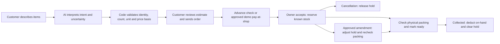

# Convenience and inventory release handoff

Tracking: [issue #8](https://github.com/sagomedia/agent-native-whatsapp-bot/issues/8) · [draft PR #9](https://github.com/sagomedia/agent-native-whatsapp-bot/pull/9).

This branch is stacked on the preserved deployed baseline in PR #7. Do not merge it directly to an older baseline or drop the parent repairs. The original acceptance work in #6 remains open for actual owner/device and settlement checks.

## Implemented behavior

Code asks for the next missing fact, keeps useful photo comparison and places the cart action outside the carousel. Final shop quotes use the invoice renderer, explain actual price changes and require approval tied to the current delivered quote. Unknown products/prices are retained without guessed totals. Tamil intentionally includes familiar English words.

AI interprets language and ambiguous requests. Code owns cart mutations, totals, consent, inventory movements and status transitions. Payment, shop acceptance and preparation remain separate facts.

## Database and activation boundary

Schema **35** adds exact three-decimal on-hand/reserved quantities, inventory versions, order holds, append-only movement records and packing checks tied to the effective order revision. Existing orders migrate as `legacy`; migration never deducts or reserves their stock. Reconciliation is an explicit owner action.

Before activation, take a fresh private database/environment backup, verify the source/artifact manifest, stage the unchanged dependency/runtime bundle, then verify readiness, the schema, release identity, historical-order preservation and stock invariants. Keep live customer messages and credentials out of GitHub/evidence. Do not replay real customer messages or simulate a received payment.

A pre-inventory release cannot honor reservations. The upgrade helper stops instead of automatically returning to old code after a schema-35 readiness failure. Repair forward with processing stopped if necessary. Never restore an old database over customer traffic.

## Verified deployment

- Active VPS release: `preview-ee77b7c4ba47`, schema **35**.
- Application source: `7bdb45a1e39e95386da3aec19528f712b91f2130`.
- Verified artifact: `58fef78a9699b8c32e4f7a448e77e8377d70c05a793ccb2961f16c0db26b532d`.
- Fresh private backup: `/var/backups/shopbot-migration/convenience-20261016T174652Z` (66,742,727 bytes).
- Service readiness passed. Environment, demo pay-at-shop and the existing UPI configuration were preserved.
- Offline before/after record fingerprints matched for all 20 checked tables, including catalog, orders, messages/media, quotes, payments and inference budgets. Existing orders remained legacy, with zero backfilled reservations/movements and no stock deductions.
- Deployed read-only owner snapshot/catalog/Tamil-gallery smoke passed; availability fields and stock invariants checked without configuring a sender/provider. Inventory MCP retained read access and no ledger-write permission.
- Production build, all **553** integration tests (zero failed/skipped), four Python catalog checks and desktop/mobile browser verification passed. Both GitHub push/PR checks passed for the deployed source.

See [deployment proof](evidence/deployment-proof.json), [integration summary](evidence/integration-summary.json), [browser proof](evidence/browser-proof.json) and [hosted CI](evidence/github-ci.json). Application source is unchanged by the later evidence/documentation commit.

Refresh the dashboard to load the new navigation and use **Message review** for wording checks. Existing orders are preserved; use the owner guide before reconciling their stock. Actual customer/device testing and real bank settlement remain in #6; this release did not generate a synthetic customer order or claim a payment receipt.

SSH unlock access was supplied by the user and used only for the authorized deployment. Future reconnection can use the existing `/home/gk-pc/.local/bin/shopbot-mcp-unlock` helper; enter the passphrase only in the terminal.
