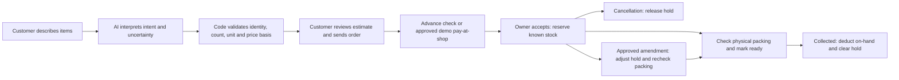

# Convenience and inventory release handoff

Tracking: [issue #8](https://github.com/sagomedia/agent-native-whatsapp-bot/issues/8) · [draft PR #9](https://github.com/sagomedia/agent-native-whatsapp-bot/pull/9).

This branch is stacked on the preserved deployed baseline in PR #7. Do not merge it directly to an older baseline or drop the parent repairs. The original acceptance work in #6 remains open for actual owner/device and settlement checks.

## Implemented behavior

Code asks for the next missing fact, keeps useful photo comparison and places the cart action outside the carousel. Final shop quotes use the invoice renderer, explain actual price changes and require approval tied to the current delivered quote. Unknown products/prices are retained without guessed totals. Tamil intentionally includes familiar English words.



AI interprets language and ambiguous requests. Code owns cart mutations, totals, consent, inventory movements and status transitions. Payment, shop acceptance and preparation remain separate facts.

## Database and activation boundary

Schema **35** adds exact three-decimal on-hand/reserved quantities, inventory versions, order holds, append-only movement records and packing checks tied to the effective order revision. Existing orders migrate as `legacy`; migration never deducts or reserves their stock. Reconciliation is an explicit owner action.

Before activation, take a fresh private database/environment backup, verify the source/artifact manifest, stage the unchanged dependency/runtime bundle, then verify readiness, the schema, release identity, historical-order preservation and stock invariants. Keep live customer messages and credentials out of GitHub/evidence. Do not replay real customer messages or simulate a received payment.

A pre-inventory release cannot honor reservations. The upgrade helper stops instead of automatically returning to old code after a schema-35 readiness failure. Repair forward with processing stopped if necessary. Never restore an old database over customer traffic.

## Current deployment state

The new implementation has **not been deployed**. The available SSH agent has no unlocked identities. The last verified VPS baseline was `preview-668a03eec8b7` on schema 34; current VPS state must be checked again after unlocking.

When back at the terminal, unlock the existing key with:

```sh
SSH_AUTH_SOCK=/home/gk-pc/.ssh/shopbot-checkout-01a142c9.sock ssh-add -t 2h /home/gk-pc/.ssh/google_compute_engine
```

Enter the passphrase only in the terminal. If the agent socket is unavailable, the existing `/home/gk-pc/.local/bin/shopbot-mcp-unlock` helper starts it and prompts locally. No password, PIN or OTP belongs in chat.

Local source build, focused integration checks and desktop/mobile browser checks passed. A final complete sequential regression and immutable release packaging are in progress; their actual results are recorded in the implementation tracker/evidence once completed.
