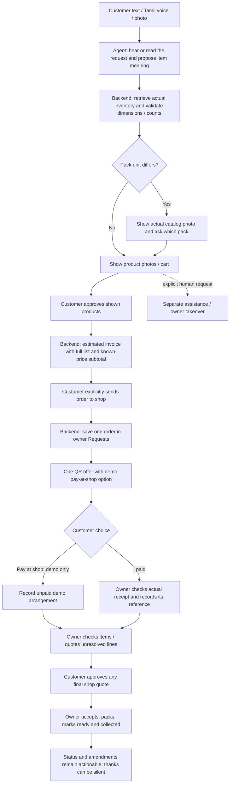

# Guided checkout and demo payment — 15 October 2026

The recording exposed separate problems in retrieval, presentation, progression and payment wording.

1. The customer's paint request retained a 10 litre pack while the normalized search name contained 10 kg. The hard pack filter discarded the actual catalog photo. Retrieval now keeps real identity matches as explicit pack alternatives, retaining brand, family and other specifications. Selecting a displayed alternative records the original requested unit and the accepted SKU; there is no automatic litre/kg conversion.
2. The live inventory also contains a paint labelled 10 kg whose selling unit is recorded as litre. This deployment does not invent a corrected selling unit or price. Such a line remains visible and can go to the shop in an order, with its unverified price excluded until the owner quotes it. Its original requested count and container stay visible on the invoice and owner request even when the catalog selling count is unresolved.
3. Product and edit cards repeated human-handoff buttons. Routine product cards now offer selection/editing, with a clear next step on the final review card. Human assistance remains an explicit separate request and does not create an order.
4. The old photo-completion check required every item to be matched, preventing a mixed known/unknown list from reaching an invoice. Approving the displayed known products can now open a bounded partial estimate. Unknown products remain named and unpriced in the submitted snapshot.
5. Advance-enabled and partial reviews were rendered as read-only text, bypassing the visual invoice. The invoice now includes images plus the complete spaced text list. Only the last invoice page carries order consent, and the complete delivered review is required before submission.
6. Everyday checkout phrases and model-recognized estimate intent now guide the customer to the next step. A price enquiry still reads the latest inventory price without changing the cart/review. Its invoice has a separate continue-checkout action.
7. The pending advance reply previously replaced later order replies repeatedly. It now offers the QR once automatically. The demo QR includes **கடைல பணம் தர்றேன்**. This records `pay_at_shop`, `payment=not_requested`, and `advance_required=false`; no receipt, payment reference or paid state is fabricated. Owner acceptance, preparation and pickup remain explicit owner actions.

## Flow and responsibility

Model interpretation proposes meaning and natural clarification. Prices, pack compatibility, invoice totals, consent, order creation, payment facts and owner transitions remain deterministic.

## Demo configuration and review

`UPI_DEMO_PAY_AT_SHOP_ENABLED=true` enables the demo choice only with the existing configured UPI recipient. It defaults to false. Each newly created advance records whether the choice was permitted, and the action checks both current configuration and the scoped order. Production keeps the actual advance-verification gate. Additive migration 34 stores the demo permission and the one-time offer timestamp and adds the unpaid `pay_at_shop` state.

All fixed Tamil replies, buttons and message templates are in [the complete editable wording review](TAMIL-ALL-DETERMINISTIC-COPY.md). Its source map is [TAMIL-COPY-SOURCE.json](TAMIL-COPY-SOURCE.json). Add replacements beneath the stable IDs while retaining placeholders. Input aliases and model instructions have separate sections.

Validation and the deployed release are recorded after the final checks. No real bank payment or test WhatsApp message is required to exercise the isolated test flow.
