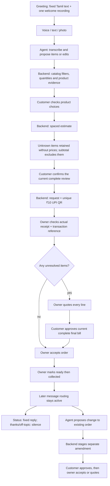

# Customer ordering implementation

The customer can start with voice, text or a photo, check products, review a spaced estimate, and request the order. A standalone ₹10 UPI advance is credited against the final bill. A customer saying “paid” is a claim; only the authenticated owner records receipt after checking their bank/UPI app and entering the real transaction reference.

## Flow and authority

Deterministic code owns prices, quantities, review bindings, payment/refund state, order transitions, reply delivery, and silence. The model interprets customer meaning and proposes edits. It cannot mark money received, accept an order, invent a price, or apply a submitted-order change.

## Where to change wording

- `02-Build/shopbot-ai/packages/contracts/customer-copy.ts`: fixed greeting, estimates, advance, status, amendment and recovery text in English/Tamil/Tanglish. Blank paragraphs are preserved.
- `apps/server/src/adapters/tamil-style.ts`: shared natural Tamil style instruction for model-generated questions and explanations. Ordinary words like voice, list, item, bill, order and confirm are retained naturally.
- `services/visual-ordering.ts`, `discovery-replies.ts`, `shopping-actions.ts`, `product-verification.ts`, `request-status.ts`: product choices and existing stage labels, now using shorter spoken Tamil.
- The approved `TAMIL-REPLY-REVIEW.md` is the phrase review checklist. Review it with real phone recordings; synthetic text fixtures do not establish human speech quality or a recognition percentage.

## Backend behavior

- Unknown items retain the customer's name and quantity and carry no fabricated price. Their prices are excluded from the known subtotal. An all-unknown list does not show ₹0 as a complete bill.
- Long estimates and final quotes preserve every section across WhatsApp messages. Consent is attached to the complete review, with version and transport delivery checks.
- The original order snapshot is immutable. Amendments and shop quotes have separate records; accepted effective lines and totals are shown to the owner.
- Exact whole acknowledgements after an order are recorded as processed without a reply or AI call. Mixed “thanks, add two more” remains actionable. Status, edits, cancellations, and a new list continue to work.
- A standalone UPI QR has no payment callback. The owner verifies actual receipt manually. No receipt is inferred from a screenshot, button, redirect or message. One bank reference cannot verify two requests.
- A late advance for a closed order is recorded as needing refund without reopening the order. Refund completion requires its actual transaction reference. The application does not send a refund itself.
- Unresolved amendments can be priced in a shop quote and require customer approval. Catalog changes invalidate direct amendment acceptance. Confirmations cannot operate across customers or stale versions.

## Owner procedure

1. In Requests, check the ₹10 bank receipt and enter its transaction reference.
2. For unresolved items, open the quote editor, fill the name, count, selling unit and unit price for every line. A price of zero requires the explicit free-item checkbox.
3. Send the final bill and wait for customer approval. Accept only after the advance and item checks are complete.
4. Mark ready when packed; mark collected when handed over. Use the notification checkbox where the WhatsApp service window permits it.
5. Review customer amendments separately. Use “Quote this proposed list” if prices or products need clarification.
6. For a cancelled order with received advance, arrange the refund in your payment app, then record its real refund reference.

## Deployment controls

New settings: `WHATSAPP_PARTIAL_REVIEWS_ENABLED`, `UPI_ADVANCE_ENABLED`, `UPI_PAYEE_VPA`, `UPI_PAYEE_NAME`, `WHATSAPP_WELCOME_AUDIO_HASH`, and `SHOPBOT_REQUIRE_VERIFIED_RELEASE`. Private merchant configuration stays in the VPS environment.

The native upgrade backs up the database and environment, checks available disk against actual bundle/database needs, switches an immutable release, and restores the earlier executable if readiness fails. Migrations are additive. The database is never automatically rolled back after new customer traffic.

The verified artifact includes the catalog photos, fonts, compiled UI/server and fixed Tamil welcome OGG. Existing spend limits, recipient allowlist, owner takeover, send gates and unknown delivery holds remain active.

## Validation limits

Offline interpretation fixtures verify routing and business rules. They do not measure real Tamil recognition accuracy. Final phone acceptance should include a Tamil voice shopping list, a confusing product name, an unknown item, a real ₹10 transfer, an edit after ordering, and a thank-you followed by a status question. Only the merchant can validate receipt and the bank-resolved recipient name.
