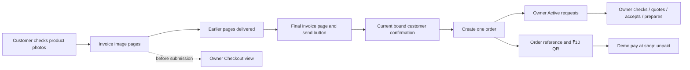

# Dashboard, checkout delivery and invoice repair

The repair is deployed. The inventory MCP is connected and configured in Codex. The saved customer cart is preserved and can continue with a fresh bill and confirmation.

| Deployment | Verified value |
| --- | --- |
| Active VPS release | `preview-668a03eec8b7` |
| Runtime source commit | `f3f97e177026f87f687adc93574b892344c534c3` |
| Artifact SHA-256 | `6fff7c7ade387802020e6d3aea25d0bc597fed02055a9a080333da59c8878b8c` |
| Database | Migration 34 retained; no new application migration |
| Tests | 538 passed; 0 failed/skipped; 30 follow-up regression checks passed |
| Release build | Clean-source TypeScript and production build passed; 133 content-verified files |
| Service | Active/running; zero automatic restarts at verification |

## Why the order and QR were missing

Checkout failed before order creation. WhatsApp accepted the invoice carousel, then delivered the later confirmation text first. The complete-review check rejected the customer's tap while the invoice images were still in flight. All three stored orders were older collected orders, so Active correctly contained zero submitted orders.

The actual provider timestamps on 16 October 2026, in America/Adak:

| Time | Event |
| --- | --- |
| 03:10:18 | Confirmation text delivered |
| 03:10:28 | Customer tapped Send order to shop |
| 03:10:31 | Invoice images delivered |

The QR is created after order submission; the rejected tap prevented its creation too.

## Repairs

- Ordered replies now wait for preceding pages to be delivered/read before sending the next page. HTTP acceptance alone cannot release a later confirmation. A bound tap can prove its own page while its receipt is delayed; other pages still need delivery evidence.
- A compact invoice holds up to eight rows per image. Confirmation is attached to the final image. Four current cart items fit on one page, with aligned quantity, rate and amount columns. Long names wrap without truncation; unknown prices remain dashes and are excluded from the subtotal. The complete text equivalent remains in the message payload and the dashboard's expandable Invoice text.
- Requests has separate Active, Checkout and History views. A prepared/expired/delayed bill remains visible as a checkout. Only a submitted order enters Active. Active orders are loaded ahead of history, and counts come from all matching store records.
- The dashboard refreshes on view/focus return and shows its last successful sync time. Manual refresh is available. Older responses cannot overwrite newer action results. Matching order references connect the customer acknowledgement to the owner request.
- The initial order acknowledgement shows the QR and order reference. Later status offers **₹10 QR காட்டு**, reusing the same ₹10 request. Closed orders do not offer or reopen advance QR requests. Demo **கடைல பணம் தர்றேன்** remains unpaid; it does not fabricate a receipt.
- Inventory MCP has six tools and a dedicated database role. Read inventory and prepare product/photo drafts; owner publication stays in Products → Drafts. The role has no published-product update, order or budget access.

Prices, invoice rows, consent, payment facts and order transitions are deterministic. Model interpretation remains responsible for reading the customer's product request.

## Files to use

- [Bulk research/image-agent prompt](BULK-CATALOG-AGENT-PROMPT.md): preserves product details, originals and provenance, rejects altered labels, and stages unpublished drafts. It references the existing corrected 100-product package rather than inventing a new import format.
- [Inventory MCP instructions](INVENTORY-MCP.md): tools, connection and a single terminal helper when the SSH key needs unlocking.
- [₹10 QR implementation and payment-app limits](UPI-QR-NOTES.md): the standard URI fields, verification boundary and official source links.
- [All fixed Tamil wording](../customer-ordering-finish/TAMIL-ALL-DETERMINISTIC-COPY.md): 425 fixed replies/labels/templates; 567 entries including separate aliases and model references.
- [Compact invoice preview](evidence/compact-invoice.png), [desktop dashboard](evidence/owner-requests-1440.png), [phone dashboard](evidence/owner-requests-390.png), and [checkout view](evidence/owner-checkout-desktop.png). These screenshots use synthetic records in the actual dashboard code.

## Verification and preservation

[Full proof](evidence/deployment-proof.json), [tests](evidence/test-summary.json), [integration output](evidence/integration-tests.log), [browser checks](evidence/browser-proof.json), and [independent QR decode](evidence/qr-proof.json).

The delayed-delivery transport test covers WhatsApp-shaped callbacks, ordered invoice delivery, bound consent, one owner-visible order, QR reopening and the unpaid demo choice. It also verifies that 110 newer historical orders cannot hide an older active order. Other tests retain price/version checks, owner preparation and pickup, unknown products and post-order messages.

Browser checks at 1440 and 390 px found no page errors or horizontal overflow. Accept, ready, refresh and stale-response behavior were exercised against an isolated loopback database. Products and Connections were also inspected. Live public checks independently confirmed readiness, welcome audio and the actual paint photo, with owner authentication and public-simulator boundaries preserved.

A rolled-back check against the real customer cart rendered all four rows on one image, retained one container for the unpriced paint, and reported the three known rows' subtotal of ₹3,195. It made no provider call or WhatsApp send and changed neither the draft nor its pending review.

Live MCP initialization returned version 1.1.0 and six tools. Two real inventory pages and a real paint search passed; no product draft was written during this live read check. The real stdio draft/photo/publication separation is covered by isolated integration tests.

Orders, advances, amendments, quotes, customer drafts/handling controls, inventory hashes, spending balances/holds and the $4.50 ceiling were preserved. Main application environment bytes were unchanged. No bank payment or customer WhatsApp test message was sent by these diagnostics.

## Resume and recovery

Reload the dashboard tab to load the new interface. The earlier attempted checkout remains saved; send **சரி பேக் பண்ணுங்க** in WhatsApp, check the fresh bill and tap **கடைக்கு அனுப்பு**. That current confirmation creates the active order and QR. Select **கடைல பணம் தர்றேன்** for the demo, then manage the order in owner Requests.

Fresh private backup: `/var/backups/shopbot-migration/dashboard-20261016T133458Z/database.dump`, 65,527,347 bytes. Restore-list validation passed before activation. Original environment, service unit, prior release pointer and private operation evidence are retained there. The preceding repair release `preview-3a10873e26da` and earlier checkout release `preview-27f9774fb582` remain available. Keep the database current when reviewing a code rollback; do not overwrite subsequent customer traffic with an older dump.

Inactive release copies were checksum-verified into private local recovery archives before removal from the VPS. Live, rollback and data-bearing releases and database backups were retained. Archiving 28 inactive installed copies recovered root disk headroom; moving 35 old upload archives separately freed temporary-filesystem space. Recovery files are `/home/gk-pc/shopbot-dashboard-verification/vps-staging-recovery/inactive-installed-releases.tar.gz` and `old-release-uploads.tar`. See [installed-copy receipt](evidence/retired-cleanup-proof.json) and [upload receipt](evidence/staging-cleanup-proof.json).
