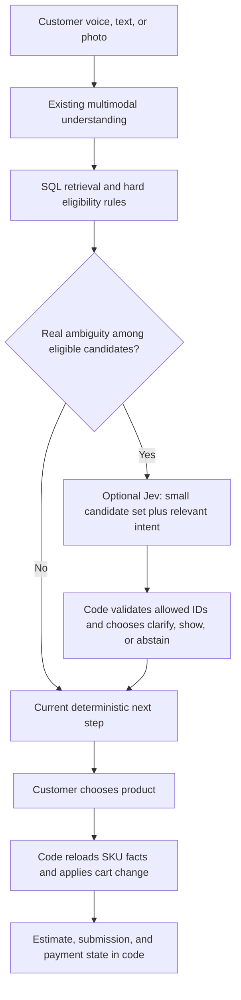

# ShopBot: recording review and optional Jev trial

Status: proposal for customer review; no application, database, payment, or deployment changes.

Reviewed 18 October 2026 UTC against source commit `99c2bf0`. The supplied 58.7-second recording is an owner-dashboard history walkthrough, not a timed checkout test. It contains no audio track. Findings below use the visible messages and transcripts; they do not independently establish speech-recognition accuracy or WhatsApp phone layout. Private recordings and customer records are not included in GitHub.

## Recommendation

Keep the current retrieval, natural corrections, product photographs, and eight-row estimate. First improve compound corrections, unresolved-item handling, compact copy, and merchant prices. Then compare an optional Jev ranker against the existing recommendation stage. A new model is not a remedy for absent prices, incorrect catalog facts, or missing photographs.

The useful part of the idea is **choosing among a short list of grounded candidates using the customer's intended use**. The risky part is treating a plausible choice as proof that two products are interchangeable. We should propose an alternative, explain its relevant difference briefly, and let the customer choose it. Code continues to control SKU identity, quantities, amounts, payment, and submission.

## What the recording actually shows

Times are positions in the recording, not message response times.

| Time | Visible evidence | Proposed response |
| --- | --- | --- |
| 00–08s | New-list/existing-order choice retains the incoming request and proceeds to switch photos. The review guide shares the carousel with products. | Preserve this working behavior and buffered request. Avoid adding another confirmation popup. |
| 08–16s | Several price/stock warnings repeat on one product. Generic `2 A switch`, `2 A socket`, and `MCP` become text-image entries; a correction opens a broad item picker. | Distinguish an unmatched description from a matched SKU lacking a photo. Ask the missing product distinction, rather than merely repeating the description as a card. Do not infer an electrical rating from ambiguous wording. |
| 24–28s | A seven-item review includes unresolved `MCP` and `pipe` alongside actual photos. A known subtotal appears while other prices remain pending. | Keep pending descriptions visible, but use one short question and genuine available choices for the current ambiguity. Unknown is not unavailable. Do not substitute an accessory or unrelated product to fill a card. |
| 32–44s | A use-based plier correction produces a relevant selection. Card captions are long and visibly end in ellipses. | Retain the correction mechanism. Prioritize name, distinguishing size/variant, price status, and required reference-photo label; remove repeated prose from each caption. |
| 46–50s | A compound correction mentions a repeated plier, keeping selected items, and removing the rest; the response falls back to a generic change menu. | Replay this exact type of correction with stable line IDs. If the keep/remove set is clear, apply it in one validated batch. If unclear, retain the goal and ask one specific question. |
| 52s | The invoice already fits eight rows. The same plier name appears twice; one count is `—`. All eight rates and amounts are `—`. | Investigate possible repeated lines; display missing count, identity, and price as distinct issues. Obtain merchant prices. Do not present an entirely unpriced list as a numerical estimate. |
| 54–57s | QR is present, followed by long payment/demo wording. A paid-button response correctly says receipt is still being checked. | Shorten the payment invitation and acknowledgement; preserve truthful receipt state and the optional pay-at-shop route. |

Repeated names do **not** prove repeated SKUs. The exact correction failure needs the stored turn's transcript, interpretation, draft IDs/SKUs, and pending edit state. The clip alone cannot tell whether the cause is transcription, target resolution, or the edit-state branch.

Source explains why duplicate-looking rows are possible: `tools.ts` merges new additions only when both lines are matched, have the same SKU, and have known counts. Selection/replacement does not globally merge lines. Existing mention reconciliation deliberately preserves explicit additions and different variants. Never deduplicate by display name.

An incomplete read-only estimate is already supported and excludes unresolved rows from its subtotal. That is useful behavior to retain. The defect to address is labeling every excluded row as merely a pending price, and losing a customer's correction goal—not the existence of partial estimates.

## Small implementation packages, in priority order

### A. Correct the cart before presenting it

- Replay “keep these three, remove the rest,” repeated-name corrections, and “remove one” against the preceding draft. Distinguish deleting a repeated line from reducing quantity by one.
- Resolve explicit keep-items to stable IDs, then compute the remove-rest set in code. Treat a linked keep-only instruction as one validated batch; on ambiguity, ask a targeted question and apply none of that linked batch.
- Preserve independent clear edits when a separate target is ambiguous, existing savepoint rollback, stale-version protection, and set-versus-add quantity handling.
- Before submission, ask only for an unresolved count or identity. Keep an explicit partial-request path when the customer wants the shop to identify an item. Do not invent a count of one.

Acceptance: exact retained IDs and quantities; different variants never merged by name; no duplicate additions from a correction; no partial mutation of a failed linked batch; submitted order snapshots remain immutable.

### B. Compact the existing presentation

Use one shared caption builder for single images, carousels, and fallback lists. The current visual builder can exceed its 160-code-point budget before the final renderer truncates it. Reserve essential fields before optional details; test Tamil wrapping on WhatsApp as well as dashboard history.

| Place | Proposed wording / behavior |
| --- | --- |
| Unknown price | `கடையில் சரிபார்த்து சொல்லப்படும்.` |
| Matched item, photo absent | Name and distinguishing variant, plus `படம் இல்லை.` Retain the actual SKU. Prefer a text/list choice when the whole response lacks photos; mixed carousels may need an honest compact text tile. |
| Unclear pipe category | `எந்த pipe வேணும்?` with applicable choices such as PVC / hose / motor pipe. Ask diameter or another required specification next only if still missing. |
| Product review | `படங்களை நகர்த்திப் பாருங்க → சரின்னா Bill காட்டு.` in the existing review carousel. |
| QR invitation | `₹10 advance pay பண்ணி order confirm பண்ணுங்க.` QR and a same-phone payment link remain accessible. |
| Claimed payment | `Payment check பண்ணிட்டு சொல்றோம். மறுபடியும் pay பண்ண வேண்டாம்.` |
| No priced rows | `விலையை கடையில் சரிபார்த்து சொல்றோம்.` No misleading ₹0 subtotal. |

Show unknown price once per product, rather than several equivalent warnings. Separate stock uncertainty from price internally; show the relevant short stock fact when it affects the decision. Keep reference-photo disclosure compact. Keep the invoice image and short caption, with full text available on request/accessibility—not a second full automatic bill message.

Remove repeated demo explanations from transaction copy. Keep the pay-at-shop option while it is enabled; use the real shop's supplied name rather than inventing branding. Record pay-at-shop as unpaid, paid-button as claimed, verified receipt as received, and shop acceptance separately. QR display or scanning is never proof of receipt.

Acceptance: essential identity/variant/price/reference label survive channel limits; no duplicate invoice message; no unknown price rendered as ₹0, including nonvisual list fallback; eight-row invoice remains readable; no extra AI calls for these wording changes.

### C. Supply merchant facts

The last deployment receipt recorded 336 active products, 324 with images and 12 without. The missing photos are six held imported images and six older products. These counts are a recorded release baseline, not a new live inventory audit.

The clip's generic unresolved entries are a separate problem: a product may be in inventory but missed by retrieval. Inspect candidate-generation diagnostics and correct specific aliases/taxonomy before adding a ranker. In particular, check the visible `MCP`/`MCB` confusion without silently deciding which was spoken.

For a finished demonstration, import merchant-approved selling prices and selling units for a representative shopping basket first, then expand coverage. Do not copy a web MRP into the shop's selling price, fabricate stock, or clear photo holds with a vaguely similar picture. The remaining records can stay price-pending with the short line above.

Acceptance: report price coverage separately from photo coverage; basket totals match the merchant's values; missing facts remain unknown. This work needs merchant facts, but copy and correction work can continue independently.

### D. Optional Jev trial, after the above

The application already has an optional `recommend` stage over current catalog observations. Extend that seam behind a feature flag instead of replacing retrieval or introducing a second cart controller. Its current result also contains an optional generated question; Jev cannot generate that prose. Map a typed missing-field decision to existing localized templates, retaining the current generative path for unfamiliar questions.

Send at most roughly 5–10 candidates for the current item, with SKU, name, family, essential specifications, intended use, and explicit unknowns. Include original wording and the existing normalized interpretation. Omit phone numbers, payment identifiers, unrelated cart lines, and long chat history. Supply an explicit `none`/`needs clarification` outcome. A correct product omitted by retrieval cannot be recovered by re-ranking that shortlist.

Ask independent bounded questions: which eligible candidate best fits this description; which distinguishing field is missing; does the proposal conflict with the stated use? Code combines the answers. A model can propose a useful alternative; diameter/thread, pressure, voltage/current, material compatibility, selling units, and customer consent remain hard constraints. A 10 kg pack is not silently equivalent to 10 L. Unknown compatibility remains unknown.

Use cases worth testing: a colloquial tool name, a use-based request such as gripping/cutting wire, close eligible variants, and an over-broad lexical ordering. Skip Jev for exact SKU selection, clear quantity changes, totals, QR, payment, and order transitions. Missing photo alone must not trigger substitution.

## What the current Jev documentation supports

- TypeSafe lists `jev-1.13.0` and `jev-1.14.0`, at **$0.042 per million input tokens**, with free outputs. Default limits are **64k per request and 32k per question**. English is its strongest language; Tamil/Tanglish performance needs our own evaluation. Pin a version for comparison rather than a moving alias. [Models](https://docs.typesafe.ai/models)
- Image input exists for both versions, but is explicitly experimental and disabled by default; it requires `TypeSafe-Danger-Zone-Images`. Image tokens are billed at the text rate, but the docs do not yet provide a dependable image-token estimator. Keep any photo suitability experiment offline initially. Jev does not generate a replacement photograph. [Images](https://docs.typesafe.ai/images)
- Typed output restricts the answer shape; it cannot guarantee the chosen SKU is semantically correct. A Choice's `confidence` is derived from its probability distribution, not an independently verified accuracy score. Determine action thresholds on our data. [Confidence](https://docs.typesafe.ai/confidence)
- TypeSafe documents errors involving negation, large irrelevant context, option order, arithmetic, and adversarial content. A reviewer can share the first model's misunderstanding. Test these cases and preserve backend validation. [Known limitations](https://docs.typesafe.ai/model-jaggedness/jev-1.13)
- The advertised 70–500 ms and large speedups are vendor results, not measurements from our VPS or Tamil catalog. [Launch report](https://typesafe.ai/blog/introducing-system-one-models-and-jev)
- Direct TypeSafe access, [Vercel's evaluation integration](https://vercel.com/changelog/ai-gateway-now-supports-typesafe-clients-and-http-api-for-jev), and [OpenRouter's decision model](https://openrouter.ai/typesafe/jev-1.14) are available paths. This is not a drop-in chat-model name change. Choose one path for a prototype; no need to migrate the existing Gemini client or pay for multiple gateways.

## Budget for one customer with 20 exchanges

Here, one exchange means one customer turn plus its bot response: **20 customer turns**, not 20 separate shopping sessions. Token totals below include request instructions, state, and questions. These are planning scenarios, not observed bills. Rupee values use an illustrative **₹90/USD**, not a current exchange-rate quote.

Jev cost = total input tokens × $0.042 / 1,000,000.

| Additional Jev calls during those 20 turns | Total input tokens | USD | INR |
| --- | ---: | ---: | ---: |
| 2 ambiguity checks × 2,000 | 4,000 | $0.000168 | ₹0.015 |
| 5 checks × 2,000 | 10,000 | $0.000420 | ₹0.038 |
| Every turn × 2,000 | 40,000 | $0.001680 | ₹0.151 |
| Every turn × 5,000 | 100,000 | $0.004200 | ₹0.378 |

Sending all 3,000 products is unnecessary. At an illustrative 80 tokens/product, that is 240,000 tokens before instructions: beyond default limits, and about **₹18.14 across 20 calls**. TypeSafe's optional long context is explicitly slower and less accurate. Retrieve first; total inventory size should not become per-turn prompt size.

Current code pins **Gemini 3.5 Flash-Lite**. Google's standard prices are $0.30/M input and $2.50/M output, including thinking; this is also the repository's reviewed rate card. [Google pricing](https://ai.google.dev/gemini-api/docs/pricing)

| Illustrative existing Gemini work | Input / output tokens per call | USD | INR |
| --- | --- | ---: | ---: |
| 20 calls, small requests | 2,000 / 300 | $0.027 | ₹2.43 |
| 20 calls, medium requests | 4,000 / 600 | $0.054 | ₹4.86 |
| 20 calls, larger requests | 8,000 / 1,200 | $0.108 | ₹9.72 |

These scenarios exclude additional voice/image tokens, retries, taxes, gateway funding fees, hosting, and WhatsApp/provider charges. They are not upper limits. Twenty turns do not imply twenty inference calls: deterministic buttons can use zero; unified understanding normally one; legacy voice may use recognition plus interpretation; repair/recommendation can add calls within the existing budget. Jev added as a reviewer adds cost; savings require replacing a validated existing recommendation call or reducing unnecessary turns.

Offline request construction found 11,049 text bytes for a short unified example and 3,858 bytes for the existing recommendation example. Bytes are not tokens, especially for Tamil. Before promising a per-customer floor, report actual input/output/thinking usage, retries, modality, and p50/p95 latency from `provider_attempts`, separately from outbound deliveries. A conservative shadow pilot cap of 500 requests × 5,000 tokens would have a nominal Jev token cost of **$0.105 / ₹9.45**, excluding retries and the surrounding pipeline; enforce a token/spend cap if the trial is approved.

Meta currently says service replies within the rolling 24-hour customer-service window are free. The earlier “first 1,000 free, then every reply charged” assumption is not supported by its current pricing page. Provider fees and templates must be checked separately. At the user's provisional ₹0.115 per delivered outbound, 20 outbounds would be ₹2.30—but that is **not a verified Meta tariff**. Shorter copy does not itself reduce message charges; fewer actual outbound messages can reduce a provider's per-message fee. [WhatsApp pricing](https://whatsappbusiness.com/products/platform-pricing/)

## Approval scope and evaluation gates

Recommended first implementation: **A + B**, plus merchant basket preparation in C. D is a separately gated experiment, not a prerequisite for a working bot.

For D, start with a proposed 120 manually labeled cases: Tamil/Tanglish synonyms and use-based tool descriptions; negation/corrections; close variants and incompatible sizes/units; absent inventory; missing photos; and unrelated/adversarial catalog text. Include the same cases with approximately 300 and 3,000 catalog rows. Keep a held-out set; do not report model-judge agreement as customer accuracy.

Compare current retrieval + current recommendation against the same retrieved candidates + Jev. Record candidate recall separately from ranking quality, wrong alternatives, abstentions, clarification turns, latency, and cost. Test shuffled candidate order and differing source/transcript interpretations. Evaluate text first; experimental images separately. Any code/SKU/amount invariant failure blocks promotion. Promote only if it improves relevant held-out match errors without worsening wrong suggestions, uncertainty handling, or latency budget. Small-sample results do not establish production reliability.

Shadow mode records decisions without changing replies. Later, an approved canary may reorder valid suggestions; customer selection remains required. Timeouts, rate limits, or missing credentials fall back to today's path or a focused question. Keep a kill switch. No checkout/payment authority moves to Jev.

Implementation locations relative to `02-Build/shopbot-ai/`:

| Area | Existing files |
| --- | --- |
| Compound corrections | `apps/server/src/runtime/conversation.ts`; `adapters/turn-understanding.ts`; `adapters/mention-reconciliation.ts`; `services/shopping-corrections.ts`; `services/tools.ts` |
| Captions and unknown facts | `packages/contracts/language.ts`; `channel-text.ts`; `apps/server/src/services/visual-ordering.ts`; `visual-images.ts`; `whatsapp-reply.ts` |
| Invoice and QR copy | `packages/contracts/customer-copy.ts`; `apps/server/src/services/order-estimate.ts`; `upi-advance.ts`; existing deterministic invoice renderer |
| Candidate ranking | `apps/server/src/runtime/conversation.ts` existing recommend stage; `adapters/google-interpreter.ts`; `services/catalog-discovery.ts` |
| Budget evidence | `services/inference-budget.ts`; `services/messaging-cost.ts`; `provider_attempts` usage records |

No full-flow redesign, wholesale model replacement, new WhatsApp account, or generated product-image substitution is proposed.
