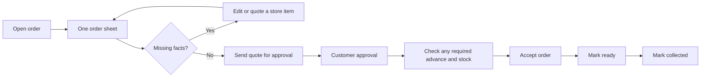

# ShopBot redesign review and implementation plan

21 October 2026 · Review and planning only, as selected by the user.

**Recommendation: adopt the clearer phone navigation, readable lists and Tamil-first direction, with one adaptive order sheet and complete recovery/fulfillment states. Do not turn every order into a mandatory item-check → pricing → bill-review wizard.**

Both proposals are specific to shop work and have useful visual hierarchy. Their main weakness is incomplete interaction design around real orders, stock reservations and interrupted work. A new color palette would not address those gaps.

## Deliverables

| File | What it answers |
| --- | --- |
| [Design audit](DESIGN-AUDIT.md) | The five most consequential findings, supporting PDF pages, what works and what remains unproven. |
| [Detailed implementation plan](IMPLEMENTATION-PLAN.md) | Corrected workflows, state/action rules, eight work packages, source files, dependencies and release boundaries. |
| [Acceptance tests](ACCEPTANCE-TESTS.md) | Business scenarios, device/keyboard/network checks and staff walkthrough criteria. All are proposed, not executed. |
| [Screen coverage](SCREEN-COVERAGE.md) | Disposition of all 30 PDF pages, including all 27 screen concepts. |
| [Evidence manifest](EVIDENCE.json) | Input hashes, inspected commit, review method, source anchors and verification limits. |

## The five priorities

1. **Make quoting adaptive.** Staff can correct identity, quantity, unit and price together. Guide them to missing facts without requiring three separate passes through complete items.
2. **Keep catalog matching optional.** Offer a store-item route, original customer wording, reference photos and editable orange suggestions. A missing digital SKU must not stop an ordinary quote.
3. **Make stock edits explicit.** Physical shelf count, reserved stock and available stock are different. Preserve unknown/unchanged/zero distinctions and the existing movement/version rules.
4. **Finish the lifecycle and recovery design.** Include waiting for approval, delivery failure/uncertainty, changed orders, payment checks, acceptance, packing, collection and interrupted saves.
5. **Prove the design at real scale and on actual devices.** Static pages do not establish mobile-keyboard fit, accessibility, global search, truthful totals, older-computer performance or staff usability.

## What stays

Four daily sections: Today, Orders, Messages and Products. Settings and message examples remain secondary. Phone lists use readable cards; desktop uses tables where repeated keyboard entry helps. Keep visible units, an explicit approval-send action, test-mode disclosure, honest unknown values and the separation of customer approval from payment.

## Proposed task flow

This shows the ordinary path. Changes, rejection, expiration, failed delivery and cancellation have explicit branches in the detailed plan. Existing complete orders can begin at the correct later stage; they do not need to be quoted again.

## Scope and evidence

Reviewed [Mobile First V2](/home/gk-pc/Downloads/temp_files/ShopBot-Mobile-First-V2.pdf) and [Desktop Complete V3](/home/gk-pc/Downloads/temp_files/ShopBot-Desktop-Complete-V3.pdf): 15 pages each. All pages were rendered and reviewed in contact sheets, with enlarged inspection of the principal workflows. Text extraction was used for explanatory notes; screenshot content was inspected visually.

Compared these with selected frontend/backend source at `f3a982747e95e37bbe58e678ea43209b696f5b54` in `/home/gk-pc/whatsapp-bot-finish`, the accepted October 20 order-sheet requirements and the project context files. No live server audit, application test run, staff study or application-code change was performed. The companion image ZIP/REVIEW.md mentioned by the desktop PDF was not supplied and was not reviewed.
