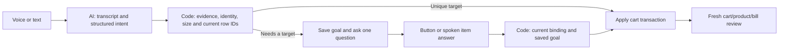

# Voice cart CRUD — 19 October 2026

Tracking: [issue #40](https://github.com/sagomedia/agent-native-whatsapp-bot/issues/40). Builds on the delivery recovery in #39.

The recording exposed a backend target-binding failure. For the clear removal request, transcription retained the product and removal wording and the model proposed the correct existing nut-and-bolt row. That unmatched row had an English name. The deterministic matcher did not bridge its Tamil name and instead scored a shared Tamil unit word on two unrelated screw rows. The fallback offered those rows as generic edits and lost the original removal goal. Separately, the Tamil-script word `ரிமூவ்` was not accepted as removal evidence.

Changes:

- Match current cart identities through their names, aliases, a small shared hardware pronunciation vocabulary, and the model's optional normalized `targetQuery`. Unit/pack-only aliases cannot identify a product. Physical sizes refine an already named identity, never its purchase count or list position. A normalized name cannot override a conflicting current ID, ambiguous literal noun or positional reference. Replacement matching considers the old item separately from its destination.
- Preserve deferred goals in version-bound `cart_edit` memory. Clarification choices retain remove, replace, quantity and additional-item actions. A tap deterministically recompiles the original goal, without another inference. A short text/voice `cartTargetAnswer` can identify the row without repeating the mutation verb. The new answer remains the inbound transcript; the original instruction remains mutation evidence.
- Linked proposed edits wait together while one target is unresolved. Confirmed selections survive subsequent questions. Independent clear additions may still proceed; another proposal must not partly mutate the unresolved row.
- Recognize Tamil-script removal wording, reject negated cart mutations, and require an explicit count in quantity-edit evidence. Entire-row removal works even when its quantity is unknown. A numeric decrement from an unknown quantity still requires a remaining total; it never assumes a count.
- Bind every callback to its displayed action, memory ID, current version, candidate row IDs, customer and existing operator controls. Repeated, forged and stale choices cannot repeat a change. These are unsent-cart edits; submitted-order changes continue through the existing shop amendment/approval flow.

The model remains the language-understanding layer; code owns cart state and transaction authorization. No Jev integration, second WhatsApp account, catalog remapping, schema migration, price edits or stock edits are needed. Existing memories remain readable. New optional understanding fields are backwards compatible; prompt version is `2026-10-19.1`.

The offline tests replay the recorded transcript against an anonymous three-row cart, then cover CRUD through actual voice ingestion and clarification, spoken answers, unknown counts, size/count separation, multi-step edit atomicity, negation and stale/forged callbacks. They establish backend behavior with controlled understanding outputs; recognition accuracy and natural Tamil still require a fresh live customer test.

Deployment must preserve the current customer cart. In particular, do not replay the historical deletion request: the customer subsequently cancelled that change. Verify the fresh native backup, catalog/photo/configuration preservation and readiness, then have the customer submit a new voice instruction.

Validation before packaging: 110 focused tests and typecheck/build pass. The complete suite and both GitHub checks remain release completion requirements. CI now uses two test workers, matching the verified local workload, to reduce contention in the existing 100-image fixture; no test or timeout was removed.
