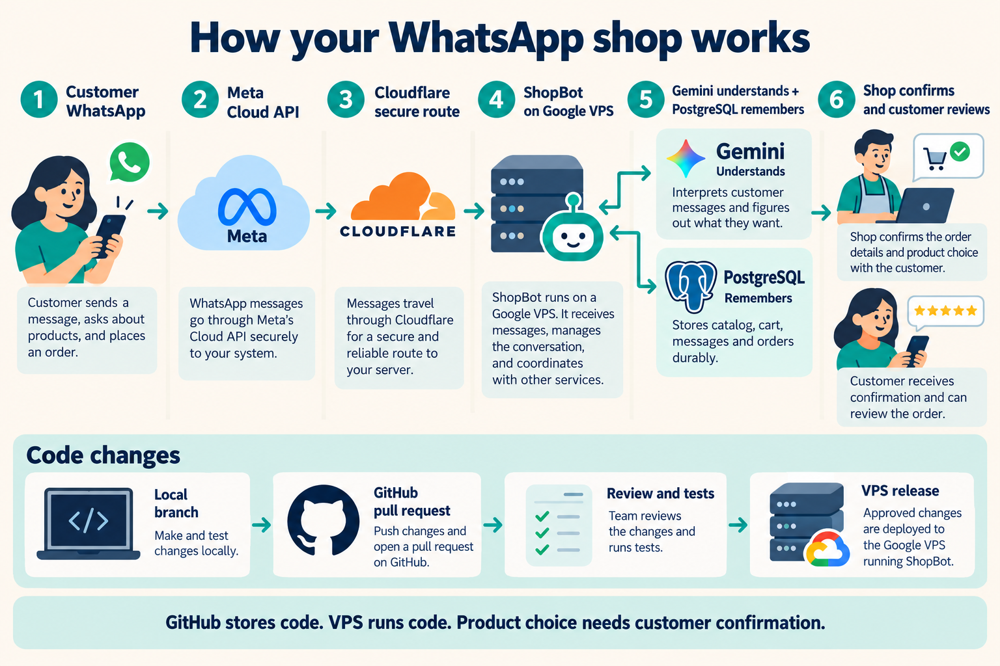
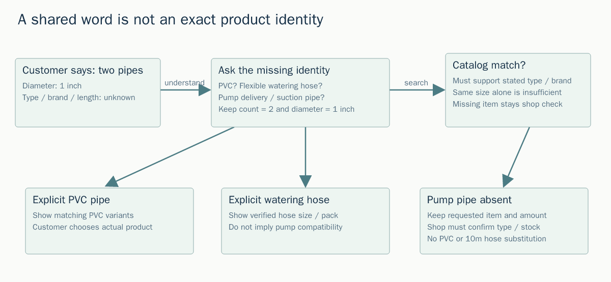
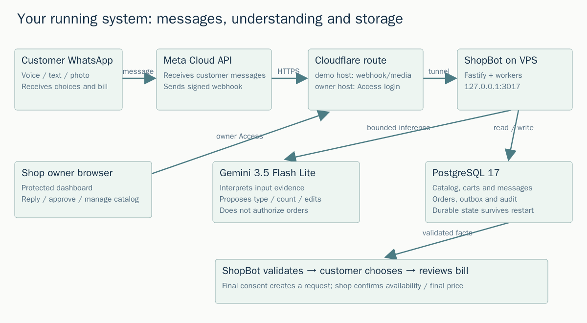
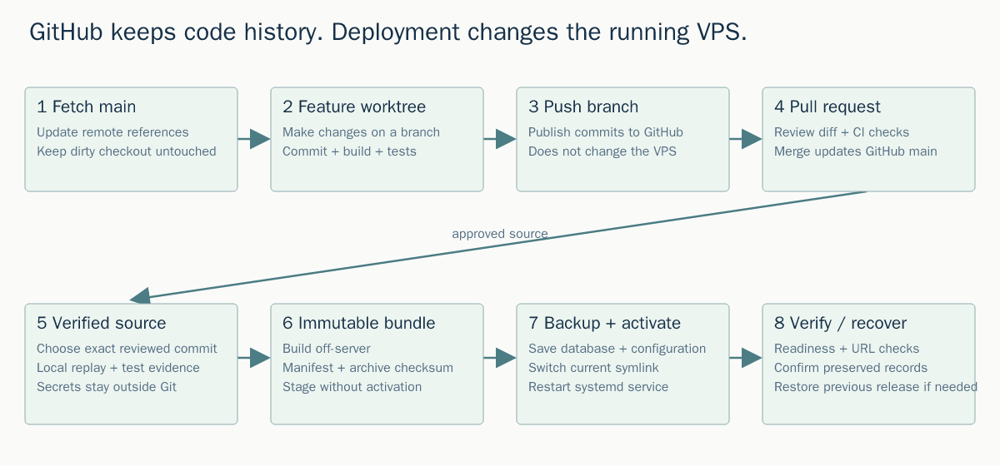

# Your WhatsApp bot: code, GitHub, URLs and the VPS

The VPS runs the application. GitHub keeps its code and review history. Gemini interprets a message; the backend checks that interpretation against real products and the current cart. Changing hosts would move the same logic and would not fix a wrong product match.



## Why the pipe request failed

“Two pipes” supplies a count, and “one inch” supplies a diameter. Neither supplies material, brand, length or pumping compatibility. A garden hose sold as a 10 m pack is also different from a rigid PVC pipe. The catalog and the model used the shared word “pipe” as if it were an exact identity. PVC spoken for a cutter also leaked into the earlier pipe item. The backend then mixed the new question with missing quantities from an old eight-item cart.

The repair preserves those separate facts, asks for the missing type or intended saved line, and shows that question in both text and the visual card. An absent pump-pipe listing stays a shop check. It does not become PVC or a garden hose merely because those are available. One “extra two” phrase cannot change three ambiguous old lines. A clear/change-everything recording offers explicit choices before clearing, and a rejected action plan can still echo a validated transcript for correction.



## Follow one customer message

1. The customer sends text, audio or a photo in WhatsApp.
2. Meta sends a signed webhook to the public demo hostname. The bot verifies it and saves the incoming message.
3. A worker loads the shop catalog, cart, current question and recent context. Known buttons and commands can run without AI. Other input goes to Gemini 3.5 Flash Lite using a reserved spending allowance.
4. Gemini returns structured product descriptions and proposed changes. It does not set prices, guarantee stock or authorize orders.
5. The backend validates source evidence, quantities, type, brand and line IDs. It retrieves actual catalog products or asks for missing information.
6. The customer checks the product, quantity and estimated bill. A separate current confirmation creates an order request. The shop confirms availability and final price.
7. Replies enter a durable outbox. Meta delivery callbacks update their status. “Generated locally,” “provider accepted” and “delivered” are different states.



## What each URL does

| Address | Purpose | What you should expect |
|---|---|---|
| `https://shopbot-preview.sagoautomation.tech/owner` | Owner dashboard | Cloudflare Access login. A redirect without login is expected. |
| `https://demo.sagoautomation.tech/webhook` | Meta's callback | Signed requests and configured verification; it is not a customer web page. |
| `https://demo.sagoautomation.tech/catalog-images/H02.jpg` | Public catalog photo | Meta must be able to fetch it without owner login. |
| `https://demo.sagoautomation.tech/catalog-images/messages/<hash>.png` | Generated question/bill card | Public visual content, with the actual card data generated by the backend. |
| `http://127.0.0.1:3017/health/ready` on the VPS | Internal readiness | Accessible inside the VPS, not a public application address. |

An image URL can work and still show the wrong product because the selected SKU is wrong. Both relevant H02/H13 URLs returned 200 in this investigation. URL routing and product understanding must be diagnosed separately. Cloudflare Tunnel connects the public route to the private origin; it is described in the [official Tunnel documentation](https://developers.cloudflare.com/cloudflare-one/networks/connectors/cloudflare-tunnel/).

## Git and GitHub, step by step

The source application is under `02-Build/shopbot-ai` in the private repository `sagomedia/agent-native-whatsapp-bot`. The feature branch is `codex/voice-order-recovery-final`.

- **Git** records local changes in commits. A branch is a line of commits.
- **Fetch** downloads remote history and updates remote references. It does not merge into your dirty working files.
- **Pull** fetches and then integrates into the current branch. Check `git status` first; avoid pulling the current dirty shared checkout.
- **Push** publishes a branch's commits to GitHub. It does not restart the VPS.
- **Pull request** compares the branch with `main`. Read **Files changed**, then **Checks** and the description. Review the deployed-baseline synchronization commit separately from the new repair.
- **Merge** updates GitHub `main`. **Deploy** builds and activates a particular reviewed commit on the VPS; it is a separate action.

This repair uses a clean worktree from current `origin/main`, preserving the old shared checkout's uncommitted work. Earlier deployed changes were not in the GitHub branch, so the first PR commit synchronizes that baseline; subsequent commits contain the new repair and learning materials. [GitHub's PR guide](https://docs.github.com/en/pull-requests/reference/pull-requests) explains the review tabs and draft stage.



A typical development sequence is:

```sh
git status
git fetch origin
git switch -c my-fix origin/main
# edit, build and test
git add <reviewed-files>
git commit -m "Describe the resulting behavior"
git push -u origin my-fix
# open a PR, review its diff and checks; merge when ready
```

The prepared CI YAML is `shopbot-ci-proposal.yml` beside this guide in the repository review folder. The existing OAuth credential can push code but GitHub rejected an executable Actions workflow because it lacks `workflow` scope. The proposal is saved as a normal review file, with no automatic CI claim. To enable it, review it and place it at `.github/workflows/shopbot.yml` using a GitHub account/credential permitted to edit workflows. It uses a temporary PostgreSQL service and offline model responses; no Gemini or WhatsApp production secrets are needed.

## Connect to and inspect the VPS

The VM is **sago-counter-ksmc**, zone **us-central1-a**. You can open Google Cloud Console → Compute Engine → VM instances → this VM → **SSH**. With the correct Google project selected and access configured, the CLI form is:

```sh
gcloud compute ssh gk-pc@sago-counter-ksmc --zone=us-central1-a
```

This session also has an existing SSH key and pinned host entry. Those remain private on your computer; they are not stored in the code, PR or generated diagrams. [Google's SSH documentation](https://docs.cloud.google.com/compute/docs/connect/standard-ssh) describes Console and CLI connection options.

Useful read-only checks inside the VM:

```sh
systemctl is-active shopbot-vps.service
readlink -f /opt/shopbot-vps/current
curl --fail http://127.0.0.1:3017/health/ready
sudo journalctl -u shopbot-vps.service -n 50 --no-pager
df -h /
```

`/opt/shopbot-vps/releases/preview-*` contains immutable runtime bundles. `/opt/shopbot-vps/current` points at the active one. `/etc/shopbot-vps.env` holds private configuration. PostgreSQL stores carts, messages and orders; restarting the service does not clear them. Generated media lives under the configured persistent service data directory.

For an upgrade: build off-server → verify archive checksum → stage → run approved replay → back up database/config → switch the current symlink → restart → verify readiness and preserved records. The upgrade script restores the previous release if readiness fails. It does not automatically restore the database; a schema-changing rollback needs a separate compatibility or restore decision. Use the existing upgrade workflow, not a first-install/uninstall script.

## Should you migrate hosting?

Keep the existing Google VPS while validating this repair. The observed failures are interpretation, catalog identity and conversation-state errors; they are not evidence that hosting migration would solve them. No Drupal CMS runs this bot. You clarified that your question concerns VPS/cloud hosting.

Consider a move or resize only with a specific measured reason: repeated memory exhaustion, disk shortage, deployment downtime, operational burden or a cost requirement. Before moving, inventory the database, private configuration, media, backups, Cloudflare routes/Access and Meta webhook configuration; verify a restore and test the new origin before switching traffic. A domain can remain the same while its origin moves, but the signed webhook, public image fetches and owner login must all continue to work.

## What to learn first

Practice one clean branch and PR; distinguish a GitHub commit from an active VPS release; inspect the current cart and pending question before blaming the model; use the health and service-log checks above; and learn backup/restore before migration. For a clean customer retest, first click **Return to assistant** if the dashboard is handling the chat, then explicitly start a new list or confirm a clear action before sending a replacement shopping list. A shorter new message alone does not authorize deleting old items.

The generated illustration is a conceptual overview. The SVG/PNG diagrams have exact editable labels and are produced by `build-diagrams.py`. The image-generation prompt is saved in `image-prompt.txt`; the built-in image tool was used. Customer audio, raw replay responses, credentials and database dumps are excluded from the learning assets and the PR.
