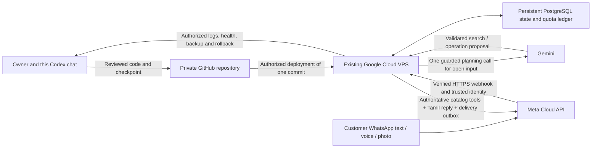

# ShopBot demo and hosting handover — 4 October 2026

Historical planning record. GitHub is now connected at [sagomedia/agent-native-whatsapp-bot](https://github.com/sagomedia/agent-native-whatsapp-bot); use `CONTRIBUTING.md` for publication and `03-Output/customer-ordering-finish/RELEASE-REPORT.md` for the later recorded deployment and owner acceptance checks. The pending fields below describe the state on 4 October.

## Current status

Tamil-first customer implementation is local. GitHub CLI sign-in was verified for **sagomedia**; the shared workspace still has no Git remote. The user may create an empty private repository and send its URL, or give an exact private repository name for creation with the existing account. Do not initialize an existing target with a second README/history; inspect it before pushing. API keys, .env, database/media volumes and SSH keys stay outside Git. Record the final repo URL and deployed commit below when connected.

The current selected Google Cloud project is **hermes-mcp-test**. A candidate existing VM was read from the account: **sago-counter-ksmc**, **us-central1-a**, **e2-micro**, **RUNNING**, **Debian 13**, **10 GB boot disk**. These are verified read-only facts, not confirmation that this is the user's intended deployment target. No SSH access, software installation, firewall change or remote deployment has been performed.

## What the owner needs to provide

1. GitHub repository URL, or exact name for a private repository under sagomedia.
2. Confirm the VM above is the intended ShopBot server. If different, provide project ID, instance name and zone from Compute Engine → VM instances.
3. Domain, if one exists. It is optional for a private server demo; the eventual Meta webhook needs a reachable HTTPS endpoint.
4. For WhatsApp connection later: Meta app ID, WhatsApp Business Account ID and phone-number ID, test recipient and the intended sender. Place access token/app secret/verify token directly in the approved secret store; never paste them into this chat or Git.

The existing gcloud sign-in can be used for authorized inspection/deployment after resolving the target. No password/private key needs to be sent to Codex. Google documents the **SSH** button and `gcloud compute ssh` workflow: https://docs.cloud.google.com/compute/docs/connect/standard-ssh . Authentication or key provisioning should use the account's existing access policy.

## Sequence and reviewable outcomes

**A. Save and demo the Tamil checkpoint.** Run the local build and regression suite. Refresh `/native-test`, choose புதிய உரையாடல், test product photos, quantity and separate final review. See `02-Build/shopbot-ai/TAMIL-DEMO.md`.

**B. GitHub.** Inspect the chosen private repository; connect the existing history and push the reviewed checkpoint after a tracked-file/history secret check. Keep the portable local bundle and source checkpoint. Record remote URL and commit. Account sign-in alone does not establish a repository or a deployment pipeline.

**C. Existing VPS, private demo first.** Inspect OS, RAM, disk space, current services and existing Docker before changing anything. Use the pinned prebuilt application image plus the pinned PostgreSQL image, named persistent volumes and the existing localhost-only bindings. Build off the small VM where practical. Preserve any existing application/database and establish backup/rollback before replacement. Keep Gemini paid authorization false and the shared quota ledger persistent. Test startup, restart recovery, media playback, retained requests and limits on the hosted server.

A private SSH tunnel can show the server demo locally without opening native-test routes to the public internet. The current local API intentionally accepts only localhost and same-origin requests; do not remove that guard merely to share a demo URL. A public browser demo needs explicit authenticated access, HTTPS, scoped durable sessions and bounded usage as an additional implementation. The e2-micro VM is a candidate for a small trial; capacity/free-tier eligibility and network/disk charges must be checked against actual usage. No resize or new paid resource is authorized by this note.

Google's legacy “Deploy container”/konlet VM option is deprecated. Use the existing VM's Docker/service deployment workflow, not that old wizard: https://docs.cloud.google.com/compute/docs/containers . Cloud Run is an optional later adapter, not required alongside this already-created VPS; its background-worker billing/runtime differences need a separate decision.

**D. Real WhatsApp connection.** Add verified Meta webhook ingress (GET challenge and signed POST body), map store/customer identity server-side, ingest message IDs idempotently and fetch bounded voice/image media with Meta credentials. Reuse the same Tamil locale, quota ledger, catalog tools, photo checks and final-consent semantics. Add a durable outbound delivery/reconciliation worker and delivery-status handling. Enforce current channel window/template rules and approved carousel counts; keep at most ten cards, no automatic image blasts. Verify actual current message-category pricing rather than treating the owner's ₹0.50 planning estimate as Meta's universal tariff.

Meta's webhook reference documents challenge verification and signature checking: https://whatsapp.github.io/WhatsApp-Nodejs-SDK/api-reference/webhooks/start/ . This reference explains webhook mechanics; it does not choose a current Graph API version or make the archived SDK the implementation dependency. Current platform documentation and account capabilities must be rechecked at the integration milestone.

Start with the Meta test sender and explicitly authorized test recipients. Submission still means “awaiting shop approval”; staff approval/payment/readiness are distinct future services. Do not expose mock resets, synthetic identity endpoints or local-only API routes as production WhatsApp endpoints.

## Connection between coding, server and WhatsApp

Codex development access is the repository plus explicitly authorized server commands/logs. The hosted backend runs independently when this app/chat is closed. Gemini is the runtime model; this coding chat is not part of the customer's request path. Access grants and CI/deployment credentials should be limited to the agreed repository/server. No permanent autonomous server connection exists just because gcloud is signed in.

## Deployment record to complete

- Repository URL: pending.
- Approved project / VM / zone: pending confirmation of candidate above.
- Deployed commit/image digest: pending remote deployment.
- HTTPS domain, backup destination and restore test: pending.
- Authentication/access mechanism and owner approver: pending.
- WhatsApp app/WABA/phone-number IDs and webhook URL: pending.
- Secret locations (names only), authorized test recipients, deployed Graph API version: pending.
- Budget, usage guards, monitoring and rollback command: pending hosted verification.
